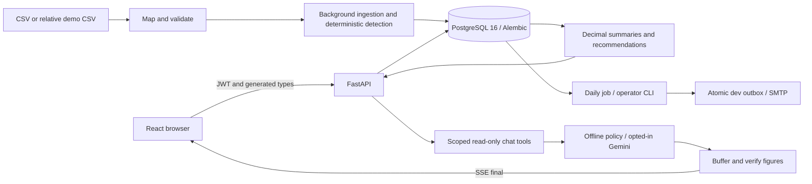

# SubTrack

[](https://github.com/devendrarajsingh07/AI-Powered-Subscription-Recurring-Payment-Manager/actions/workflows/ci.yml)

Subscription and recurring payment management from uploaded or synthetic INR transactions.
Deterministic code detects payments and computes every figure; the assistant uses read-only tools
and a server-side figure verifier. **1.0.0 means demo-complete for this scope, not production-ready.**


Register, preview/map/import CSVs or review PDF/image statements, review subscriptions and fixed bills, track renewals and budget,
review advisory savings, inspect dev emails and ask the offline assistant. A clock-relative demo
loader makes the same real ingestion pipeline available without a statement. Gemini is the single
optional live provider, replacing the previous provider at the owner's explicit request. No live eval was run.

Phase 8 is **in progress, not launch-ready**. The owner chose to keep the hosted demo free and the
real-user beta blocked. Implemented and verified locally (not yet deployed): invitation controls, shared
PostgreSQL rate limits, revocable sessions, a durable PostgreSQL job queue with a separate worker and
credential-free extractor, retention, token-gated content-free metrics, a live-AI kill switch with daily
caps and visible offline fallback, email suppression/unsubscribe, a problem-report path and versioned
legal acceptance (off by default). Container isolation, multi-container, browser and hosted-CI
verification of these packages, real email delivery, backups and legal approval are still outstanding.
Production startup fails closed.
See [implementation decisions](docs/PHASE8_PLAN.md), [launch gates](docs/LAUNCH.md),
[runbook](docs/RUNBOOK.md) and the [evidence table](docs/DOD.md). Existing demo notices remain accurate.

Statement import supports English text/scanned PDFs and JPEG/PNG through local extraction and
mandatory editable review. CSV stays 5 MB/50,000 rows; PDF/image limits are 10 MB, PDF 30 pages,
image 25 megapixels. Encrypted PDFs use a separate memory-only password field. Original files and
passwords are not retained; row previews expire after 30 minutes. Clean scans around 200 dpi or
better are the target; skew, blur and unfamiliar layouts can fail or misread digits. All extracted
rows require review, even when balances match. INR only; Excel, phone photos and handwriting are
unsupported/best effort. See [formats, evaluation, limits and private checker](docs/STATEMENT_IMPORT.md).
The synthetic evaluation has zero silent errors because every returned row is flagged; it does
not establish accuracy on real bank statements. Docker installs Tesseract/poppler; no host OCR
installation, cloud OCR, LLM extraction or API key is needed. Native Windows parsing is unsupported;
use the Linux Docker API. Run `make evaluate-extraction`; it is also included in `make test`/CI.


## Quick start — Windows, Linux and macOS

Prerequisites: Git, Docker Desktop/Engine running, Compose v2 with `up --wait`, and GNU Make.
For host verification/browser tests also install Python 3.11+, Node.js 22+ and npm. Initial clone,
image builds and package/browser installation need internet; the installed default demo runs without
an external AI service, API key, bank connection or SMTP server. Air-gapped setup needs cached images
and dependencies. Do not treat a first Docker build as an offline installation.

Clone this repository and enter its folder. On PowerShell, quote paths containing `&`:

```powershell
git clone https://github.com/devendrarajsingh07/AI-Powered-Subscription-Recurring-Payment-Manager.git
Set-Location AI-Powered-Subscription-Recurring-Payment-Manager
Copy-Item .env.example .env
```

On Linux/macOS use `cd AI-Powered-Subscription-Recurring-Payment-Manager` and `cp .env.example .env`.
The copied credentials are **development-only**. After this preparation, two commands start the seeded demo:

```sh
docker compose up --build --wait
make seed
```

PowerShell without Make: the second command is `docker compose exec api python scripts/seed_demo.py`.
Open [SubTrack](http://localhost:5173). **Local development only**, never hosted:
**subtrack-demo@example.org / SubTrackDemo2026!**.
The seed command refuses non-development environments and never resets another account's password.
Use Register for your own empty account and select **Load demo data** to follow the full demo.
The public-demo build (`PUBLIC_DEMO_ONLY=true`) offers **Start isolated demo** with no email/password: disposable
synthetic-only sessions, no file uploads, a visible privacy warning and automatic account expiry.
Do not upload real statements or personal data. The deployed cross-site demo keeps its short-lived
access token in memory and issues no refresh cookie; reloading starts a new session. This does not
relax the strict same-site session design or make the demo beta-ready.
[API docs](http://localhost:8000/docs) and [OpenAPI JSON](backend/openapi/openapi.json) document the real API.

Normal demo data is generated relative to application today in APP_TIMEZONE. The badge shows its
recorded date. Repeated loading is idempotent; remove and reload explicitly to refresh the clock.
Demo and real uploads cannot mix in an account. Settings can remove demo data without deleting the
account, or delete the account and all data after typing DELETE. Demo defaults set a missing budget
100 INR below recurring spend and a missing notification address to demo@example.org; they are editable.
No email is sent until the scheduled job or operator CLI checks due alerts.

## Three-minute tour and documentation

- [Timed demo script, measured values and fallback](docs/DEMO.md)
- [Architecture, detection, delivery, verifier and limitations](docs/ARCHITECTURE.md)
- [Privacy, disclosure and deletion](docs/PRIVACY.md)
- [Definition-of-Done evidence and honest gaps](docs/DOD.md)
- [Agent handoff/current state](PROJECT_INFO.md), [historical phases](docs/history/PHASES_1_5.md)
- [UI QA/state matrix](docs/design/QA.md), [changelog](CHANGELOG.md)

## Registration controls and data export

`REGISTRATION_MODE=open|invite|closed` defaults to open in development and closed in production;
production rejects open. This is a registration control, **not completed beta account security**.
For synthetic invitation testing, an existing issuing account is required. Operator-only commands:

```sh
make invite ARGS='create --issuer UUID --email synthetic@example.org --hours 48'
make invite ARGS='revoke --issuer UUID --invite-id UUID'
```

The code is printed once to the private operator terminal. Never paste it into public logs/issues.
The CLI has no web admin route. An invitation is HMAC-hashed, email-bound, expires within 1–168 hours,
and can be consumed only once atomically. Signing-key rotation also invalidates outstanding invites
and rate-limit digests. Registration accepts an optional invitation-code field; invalid/revoked/
expired invitations have the same safe error. Do not invite real users before launch gates pass.

Settings **Export my data**, backed by `GET /api/v1/me/export`, downloads scoped JSON with Decimal
strings and excludes passwords/invitation/authentication material. It contains private transaction
descriptions; keep it outside source control and shared folders. Security-event rows contain only
kind, UUID, timestamp and optional account UUID. Failed unknown logins have no account association;
their retention purge is still pending. These are minimal audit records, not full incident telemetry.

Auth/auxiliary request throttling now uses shared PostgreSQL fixed windows. It fails closed on store
outage, uses HMAC peer-address keys and expires inactive buckets on subsequent limited requests.
It does not trust forwarded headers; the deployed proxy/client-address policy needs beta validation.
Account-level backoff is now PostgreSQL-backed for known and unknown emails. Shared chat guards
and durable global job caps remain outstanding; do not confuse account security with their completion.



## Commands and tests

| Command | Purpose |
| --- | --- |
| make dev / make down | Build/start healthy dev stack / stop without deleting volumes |
| make verify | Web, API proxy and migration-head readiness |
| make seed | Dev-only idempotent synthetic account and real ingestion |
| make test | Real PostgreSQL pytest, detector evaluation, OpenAPI check, Vitest and TS drift |
| make lint | Ruff, ESLint and TypeScript |
| make evaluate | Precision/recall/F1 on synthetic and handwritten fixtures |
| make e2e | Real-stack Chromium seven flows plus Firefox/WebKit three main flows each |
| make openapi / make types | Export contract / regenerate TypeScript types |
| make chat-eval | Eighteen independent known-answer questions, offline default |
| make chat-eval-live | Owner-only opt-in live Gemini evaluation; excluded from CI |
| make run-alerts AS_OF=YYYY-MM-DD | Same daily job with an explicit simulated date |
| make outbox | Export private dev MIME copies into ignored var/outbox |
| make sample | Regenerate committed synthetic fixtures (not needed for demos) |

Host browser setup and production bundle check:

```sh
cd frontend
npm ci
node node_modules/@playwright/test/cli.js install chromium firefox webkit
npm run build
npm audit --audit-level=low
cd ..
make e2e
```

On Linux CI install browsers with `--with-deps`. Windows can use `npm.cmd` when PowerShell blocks
its shim. Scripts invoke Node directly to support ampersands in directory names. Playwright uses
real Compose PostgreSQL/API, never mocked happy paths; MSW is used only for typed component tests.
The wrapper explicitly fixes the **test** clock to committed ground truth, then restores the normal
clock in a finally block. Pass arguments with `python scripts/run_e2e.py demo.spec.ts --project=chromium`.
Failed browser runs can leave synthetic accounts; successful flows delete their accounts/outbox.
Reports/traces are ignored because they can contain short-lived tokens. Do not publish private traces.

On this Windows host the downloaded Firefox157 executable failed before page launch with a native
side-by-side activation error (dependent assembly mozglue). Chromium and WebKit run locally.
Until that host runtime is repaired, run `python scripts/run_e2e.py --project=chromium --project=webkit`
to exercise available browsers. The default `make e2e` keeps Firefox enabled and reports its failure;
Ubuntu CI installs all dependencies and runs all three engines. No failing browser is silently skipped.

The API's `/api/v1/openapi.json` is checked in with an endpoint summary under backend/openapi.
`make types` uses openapi-typescript; never hand-edit src/api/schema.ts. Build/test fail on drift.
Money stays decimal strings with Indian grouping; charts only derive dimensionless BigInt coordinates.
Access tokens use memory only; older sessionStorage credentials are removed. Strict same-site mode
uses rotating Secure/HttpOnly/SameSite=Strict host-only refresh cookies with CSRF protection and
server revocation; the cross-site public demo issues no refresh cookie. Tokens/codes never enter URLs
or application logs. See [account-security decisions and TLS stand-in](docs/PHASE8_ACCOUNT_SECURITY.md).
Theme light/dark/system is a non-sensitive guarded localStorage preference applied before paint.
Browser axe covers every page in both themes at 360px; 360/768/1280 overflow checks are automated.
A real screen-reader pass remains a human task.

## API and limits

All business routes are under `/api/v1`, protected by JWT. Auth: register/login/me; uploads:
preview, submit, list/detail; subscriptions: filters/sort/page/detail/patch; summary/trend/savings;
renewals/upcoming; budget; settings/alerts; category confirmation/suggestion; recommendations;
alerts; chat/config/history; demo/load and demo/data; DELETE me/data. See the checked-in contract
for exact fields and examples. Login errors do not enumerate users. Passwords require 12+ characters,
three character classes, at most 72 UTF-8 bytes. Auth/chat/demo requests are rate-limited.

CSV supports simple amount/type or separate debit/credit layouts, inferred delimiter/date formats,
confirmed mapping, 5 MB and 50,000-row limits. INR only. Raw descriptions are stored untouched;
previews/charges are formula-safe text. Bad rows yield safe warnings/counts. Broken quoting preserves
preceding rows and treats the unreadable remainder as one malformed record. Upload returns 202;
poll its persisted stage/counters. Financial writes are atomic and DB-deduplicated across concurrent
uploads; the worker/scheduler/limiters support one API instance, not a distributed deployment.

Normalizer strips rails/noise/references and applies aliases. Cadence tolerance is 7±1 /30±4 /
91±6 /365±10 days; regularity ≥0.7, amount CV ≤0.15; three charges or two yearly. Amount clusters
separate products when possible. User confirmations/cancellations/categories survive re-detection.
Missed cycles are uncertainty only. Rent/loan/insurance/utilities are fixed bills, excluded from savings.
Measured F1 is on synthetic and handwritten fixtures, **not an accuracy claim for real statements**.

Duplicates estimate all but the most expensive overlapping music/streaming/cloud plan. High-cost
and price-increase items have no savings estimate; extra cost is labelled separately. Possibly-unused
requires user-reported last use. Accept records review intent and never changes subscription status.
All explanations/emails are deterministic advisory templates, not financial advice.

## Alerts and private outbox

Daily local-time scheduler and `make run-alerts` share a PostgreSQL-locked job. Subscriptions only
for renewal emails, excluding fixed bills, stopped uncertainty and past dates; one budget alert per
user/calendar month including all recurring bills. Blank recipient means skipped. The console notifier
(default) creates HTML/plaintext .eml files in the Docker outbox_data volume under user UUID folders;
`make outbox` exports them to ignored var/outbox for your mail viewer. They never go to app logs.
Account deletion purges private dev copies; exported files/delivered emails cannot be recalled.

Console atomic file publication recovers send-before-commit crashes without a second artifact.
SMTP supports TLS/timeouts/bounded retry and safe terminal failure visibility. **SMTP remains
at-least-once** across acceptance/commit crashes. No exactly-once inbox delivery claim is made.
Settings shows notifier mode and recent alerts; no unauthenticated job-trigger endpoint exists.

## Offline and live Gemini

**Read the API tier's terms before enabling live mode.** Google's
[Unpaid Services terms](https://ai.google.dev/gemini-api/terms) permit product improvement and human
review; do not submit sensitive/personal financial data on that tier. Paid Services exclude
product-improvement use but allow limited safety/legal retention. The app cannot determine your
key's tier. See [billing](https://ai.google.dev/gemini-api/docs/billing) and [privacy](docs/PRIVACY.md).
Offline remains the default; a live key/model is never used in CI or default tests.


Default LLM_PROVIDER=fake uses a deterministic tool-using policy, with no hard-coded figures or
network. It handles recognized questions and says when information is unavailable. For optional live
use set LLM_PROVIDER=gemini, a Gemini LLM_API_KEY and an available LLM_MODEL in your private .env,
then restart the API. LLM_BASE_URL defaults to Google's API. No key is shipped. The sole live adapter
uses [Gemini REST function calling](https://ai.google.dev/gemini-api/docs/generate-content/function-calling)
and preserves signed response parts. Tests use local HTTP only; live quality is **not measured** here.

Upgrading a Phase6 checkout: replace its old LLM_BASE_URL with
`https://generativelanguage.googleapis.com` before enabling live Gemini. Existing private .env files
are not overwritten by a Git update. Keep the default fake mode until you supply your own key/model.
Migration0007 revokes previous live-provider consent; a previous-provider opt-in does not authorize Gemini.
Each user must explicitly consent again to the newly disclosed recipient.

Per-user consent defaults off and is checked before chat/category calls. The drawer discloses that
redacted question/recent history, instructions/tool schemas and scoped merchant names/categories/
amounts/dates/counts leave for Gemini. No raw descriptions, email, account IDs or tokens are sent.
Do not type personal material: redaction is not a complete PII filter. Categorization sends only a
normalized merchant plus fixed category schema; suggestions remain unconfirmed until the user acts.

Seven strict read-only tools cannot accept a user ID. PostgreSQL read-only transactions enforce no
writes. Five-round cap, timeout/cancellation, one in-flight turn and minute/day caps bound work.
SSE streams tool status then a buffered final; unverified model tokens never reach the browser.
The verifier normalizes amounts/percentages/dates/counts against this turn's typed tool results.
Unverifiable figures become a marked deterministic fallback. This checks **figure provenance, not
prose truth or associations**. Chat history can be cleared and cascades on account deletion.
Recommendations and emails are never LLM-phrased. `make chat-eval-live` sends synthetic data only,
explicitly opts its test user in, prints a question pass/fail table and verifier blocks, and is not CI.
The owner supplies a key/model; **we did not run it**. Near misses must be blocked, not accepted
merely to improve an evaluation score.

## Security checks and deployment boundary

Python dependencies are transitively pinned with hashes in requirements.lock; Docker/CI enforce it.
Audit the lock with `pip-audit -r backend/requirements.lock --disable-pip` in an environment containing
pip-audit; npm audit is above. Full-history Gitleaks: `gitleaks git --redact .`. See DOD for actual runs.
Neither .env nor statements, outbox, keys or browser traces belong in Git. Use private-statements/
(ignored) or files outside the checkout. No license file is chosen/added by this phase; MIT selection
is recorded for the owner in the handoff.

API/web run as non-root; PostgreSQL's entrypoint drops to its postgres user. Health checks include
migration-head readiness. Web and data API responses set nosniff, no-referrer, frame denial and CSP.
Swagger's CDN-based page is exempt from the data API's deny-all CSP. Vite requires inline dev scripts/
styles and websocket connections; production must use a built static server with a stricter policy.
ENVIRONMENT=production refuses test clocks, demo loading and console notifier; outside development
weak/default JWT and implicit/wildcard CORS are rejected. Demo seeding is development-only and
adversarial FakeLLM is test-only. These guards do not turn Compose into a production deployment.
Production needs TLS, secrets management, backups/monitoring, durable jobs/limits and security review.

## Optional private statement check

Do not upload a real statement to an agent or commit it. On your machine only, use a redacted export
outside Git or in ignored private-statements, with the locked backend environment installed:

```sh
python backend/scripts/check_statement.py /absolute/private/redacted.csv --as-of YYYY-MM-DD
```

It prints detections/counts only to your terminal, uses no database/LLM/network, and writes nothing.
Compare against your known plans and report precision/recall yourself. The script was exercised with
a committed handwritten synthetic fixture only; your real-bank accuracy remains unmeasured.

## Troubleshooting

- Docker connection failure: start Docker Desktop/Engine and wait until healthy before make dev.
- Windows PATH: restart the terminal after installing Make/Docker/Node; refresh machine+user PATH
  if the current terminal predates installation. PowerShell may require npm.cmd.
- Ampersands/spaces: quote absolute paths with `Set-Location -LiteralPath 'C:/path with & characters'`.
  Use repository scripts instead of building shell command strings from user data.
- Bind mounts not updating: VITE_USE_POLLING=true is enabled in Compose; rebuild after Vite config changes.
- Port conflict: set API_PORT/WEB_PORT and explicit WEB_ORIGIN consistently; set E2E_BASE_URL for tests.
- Failed/interrupted upload: inspect safe progress message, retry real uploads; for a failed demo,
  remove demo data in Settings then load again. No half-written financial data is committed.
- Stale demo dates: badge shows generation date. Remove/reload explicitly; never shift uploaded history.
- Missing dev mail: check recipient/enabled/lead time and planned send_on in Settings, then run the
  job at that explicit date. Renewals already past or possibly stopped are deliberately skipped.
- Schema mismatch: run make dev to apply Alembic head, then make verify. Never use create_all.

## Environment reference

Values below reflect .env.example; restart after changes. SMTP and live Gemini are optional.

| Variable | Example/default |
| --- | --- |
| `ENVIRONMENT` | `development` |
| `DEMO_ENABLED` | `true` |
| `POSTGRES_DB` | `subtrack` |
| `POSTGRES_USER` | `subtrack` |
| `POSTGRES_PASSWORD` | `Private; see development-only example` |
| `DATABASE_URL` | `postgresql+psycopg://subtrack:subtrack_local_only@db:5432/subtrack` |
| `JWT_SECRET` | `Private; see development-only example` |
| `JWT_ACCESS_MINUTES` | `30` |
| `JWT_ISSUER` | `subtrack` |
| `JWT_AUDIENCE` | `subtrack-web` |
| `BCRYPT_ROUNDS` | `12` |
| `AUTH_REGISTER_LIMIT` | `5` |
| `AUTH_LOGIN_LIMIT` | `10` |
| `AUTH_WINDOW_SECONDS` | `60` |
| `AUTH_SESSION_LIMIT` | `60` per peer/window, separate bootstrap/refresh buckets |
| `AUTH_REFRESH_DAYS` | `14`, rotating host-only cookies in strict mode |
| `ACCOUNT_TOKEN_MINUTES` | `15`, hashed single-use email/reset code |
| `ACCOUNT_BACKOFF_THRESHOLD` | `3`, PostgreSQL account-keyed exponential backoff |
| `REQUIRE_EMAIL_VERIFICATION` | `false` only for development; mandatory in production |
| `AUTH_SESSION_MODE` | `strict`; `demo` requires all public-demo-only safeguards |
| `PUBLIC_DEMO_ONLY` | `false` locally; forced true by the hosted demo entry point |
| `DEMO_ACCOUNT_TTL_HOURS` | `24` maximum; 15-minute awake/startup purge |
| `API_ORIGIN`, `AUTH_COOKIE_SITE` | Explicit HTTPS sibling API origin and registrable owned site for production |
| `APP_TIMEZONE` | `Asia/Kolkata` |
| `UPLOAD_WORKERS` | `2` |
| `UPLOAD_QUEUE_LIMIT` | `8` |
| `WEB_ORIGIN` | `http://localhost:5173` |
| `VITE_API_BASE_URL` | `/api/v1` |
| `VITE_API_PROXY_TARGET` | `http://api:8000` |
| `VITE_USE_POLLING` | `true` |
| `API_PORT` | `8000` |
| `WEB_PORT` | `5173` |
| `LLM_PROVIDER` | `fake` |
| `LLM_API_KEY` | `Private; see development-only example` |
| `LLM_MODEL` | `(empty)` |
| `LLM_BASE_URL` | `https://generativelanguage.googleapis.com` |
| `LLM_MAX_TOKENS` | `1024` |
| `LLM_TIMEOUT_SECONDS` | `20` |
| `LLM_RETRIES` | `2` |
| `CHAT_TIMEOUT_SECONDS` | `60` |
| `CHAT_HISTORY_WINDOW` | `8` |
| `CHAT_MINUTE_LIMIT` | `10` |
| `CHAT_DAILY_LIMIT` | `100` |
| `APP_TEST_AS_OF` | `(empty)` |
| `NOTIFIER_PROVIDER` | `console` |
| `SCHEDULER_ENABLED` | `true` |
| `ALERT_JOB_HOUR` | `9` |
| `ALERT_JOB_MINUTE` | `0` |
| `ALERT_MAX_ATTEMPTS` | `3` |
| `ALERT_RETRY_SECONDS` | `300` |
| `SMTP_HOST` | `(empty)` |
| `SMTP_PORT` | `587` |
| `SMTP_USERNAME` | `(empty)` |
| `SMTP_PASSWORD` | `Private; see development-only example` |
| `SMTP_FROM` | `(empty)` |
| `SMTP_SECURITY` | `starttls` |
| `SMTP_TIMEOUT_SECONDS` | `10` |
| `HIGH_COST_YEARLY_INR` | `12000` |
| `HIGH_COST_SHARE` | `0.35` |
| `UNUSED_DAYS` | `60` |
