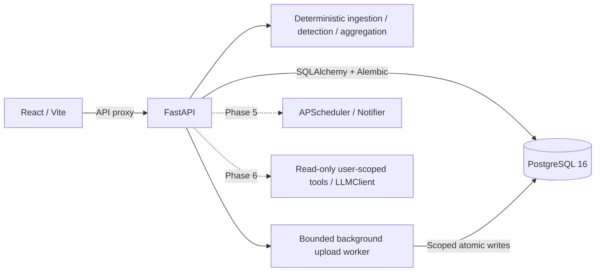

# SubTrack

AI-powered subscription and recurring payment manager for uploaded or synthetic INR transactions.
**Current delivery: Phase 4 frontend on the authenticated PostgreSQL backend.**
Register, upload a CSV, review detections, explore spending and manage your preferences in the UI.
Recommendations, chat, email delivery and one-click demo seeding arrive in Phases 5–7.
See [PROJECT_INFO.md](PROJECT_INFO.md) for the agent handoff, specification, phase gates, and verification log.

## Prerequisites and startup

- Docker Engine/Desktop with Compose v2 supporting `up --wait`.
- GNU Make (optional: use the equivalent Docker commands below).
- Python 3.11+ for `scripts/verify_stack.py`.

From the repository root:

```sh
cp .env.example .env
make dev
make verify
make test
make lint
```

PowerShell without Make:

```powershell
Copy-Item .env.example .env
docker compose up --build --wait
python scripts/verify_stack.py
docker compose run --rm --no-deps api pytest -q
docker compose run --rm --no-deps api ruff check .
docker compose run --rm --no-deps web npm test -- --run
docker compose run --rm --no-deps web npm run lint
docker compose run --rm --no-deps web npm run build
```

Web: [localhost:5173](http://localhost:5173). API docs: [localhost:8000/docs](http://localhost:8000/docs).
The React app calls the real API through Vite's `/api` proxy.
PostgreSQL is internal to Compose and persists in a named volume. API startup runs Alembic.
`docker compose down` stops services without deleting database data.

`make seed` is reserved for Phase 7 and currently exits with an explicit not-implemented error.
Authentication, PostgreSQL persistence, background CSV uploads and business APIs are available.
Recommendations, alerts/scheduler/email, chat and demo seeding are later phases.

## Frontend development and verification

Node.js 22+ and npm are required for local frontend development and browser tests. Compose includes
the web runtime; a local npm install is only needed for local scripts and Playwright.

```sh
cd frontend
npm ci
npm run dev
npm test -- --run
npm run lint
npm run typecheck
npm run build
npm audit --audit-level=low
node node_modules/@playwright/test/cli.js install chromium
cd ..
make dev
make e2e
```

On Linux, use `install --with-deps chromium` to install browser system dependencies. On Windows use
`npm.cmd` when PowerShell blocks npm's script shim. The npm scripts invoke Node entrypoints directly
to support workspace paths containing `&`. `make e2e` runs three Chromium flows against the real
Compose services, with fresh synthetic accounts; it does not mock the API. Set `E2E_BASE_URL` to
test a different local stack. Test accounts are deleted by successful runs. Failed runs can leave
synthetic accounts for investigation; remove them through Settings. Reports/traces are ignored and
must be treated as private because browser traces can contain short-lived test tokens.

`make types` (or `cd frontend && npm run types`) generates `src/api/schema.ts` from
`backend/openapi/openapi.json` with openapi-typescript. Do not edit generated types. `make test`
checks both the backend OpenAPI export and TypeScript drift; the frontend build also checks drift.
The thin openapi-fetch client uses these generated paths and schemas. In Compose the schema is
mounted read-only at `/contract`; `SUBTRACK_SCHEMA` overrides its location for generation only.

`VITE_API_BASE_URL` defaults to `/api/v1`; `VITE_API_PROXY_TARGET` is the server-only Vite proxy
destination. Do not put secrets in `VITE_*` variables. Compose enables `VITE_USE_POLLING=true` for
reliable source updates on Windows Docker bind mounts. Restart/rebuild after changing Vite config.

Access tokens stay in memory with a per-tab sessionStorage fallback. Logout, expiry and protected
401 responses clear the token and Query cache. This allows tab reloads but remains vulnerable to
XSS; uploaded/server text is never rendered as HTML. No refresh token exists. Money is displayed
from API decimal strings with Indian grouping. Charts use BigInt-based dimensionless coordinates;
tooltips, legends and table alternatives retain exact API strings. The browser computes no totals,
projections or savings. Amount sorting is performed by the API.

The UI includes keyboard-operated native dialogs, visible focus, a skip link, dark/light tokens,
and chart data-table alternatives. Vitest uses MSW responses typed from the generated contract;
axe checks structural accessibility in jsdom and full browser checks cover contrast as well.
Screenshots with synthetic data are in [docs/screenshots](docs/screenshots). Design decisions and
verification evidence are recorded in [PROJECT_INFO.md](PROJECT_INFO.md).

## Backend API and upload flow

The complete contract is checked in at [openapi.json](backend/openapi/openapi.json), with a readable
[endpoint summary](backend/openapi/SUMMARY.md). `make openapi` regenerates both from the application;
`make test` checks they are current. Swagger UI is at `/docs`.

1. Register with `POST /api/v1/auth/register`; log in with `POST /api/v1/auth/login`.
2. Send `Authorization: Bearer <access_token>` for every business endpoint.
3. `POST /api/v1/uploads/preview` with multipart `file` returns delimiter, detected date formats,
   safe preview rows, suggested mapping and capped row warnings. It creates no database records.
4. Confirm the mapping, then `POST /api/v1/uploads` with multipart `file` and `mapping`, a JSON
   object encoded as a form string. Example mapping:
   `{"date":"date","description":"description","amount":"amount","type":"type"}`.
5. The upload returns **202 pending**. Poll `GET /api/v1/uploads/{id}` for `stage`, processed/total
   rows, inserted/duplicate/malformed counts, and `done` or `failed`. Stages reflect real worker
   activity: parsing, waiting for user lock, ingesting, detecting, done. Financial writes commit
   atomically; a failed upload has no partial transaction/subscription/charge-link changes.
6. Read `/subscriptions`, `/subscriptions/{id}`, `/summary?period=month|year`,
   `/summary/trend?months=12` and `/renewals/upcoming?days=30`. Lists use limit/offset and totals.
7. Use `PATCH /subscriptions/{id}` for confirmation/status/category/last-used decisions,
   `GET/PUT /budget`, `GET/PUT /settings/alerts`, and the unconfirmed category routes.
8. `DELETE /api/v1/me/data` permanently deletes the account and all owned records in one transaction.
   The caller's tokens stop working; other users are unaffected.

Money is always a decimal string (e.g. `"119.00"`), never a JSON float. Budget input must be a
nonnegative decimal string with at most two decimal places. Summary totals project all active
recurring products, with subscriptions and fixed bills shown separately. Weekly projection uses
52 charges/year, quarterly 4, yearly 1; monthly equivalent is annual/12, rounded once at aggregation.
Trend values are actual linked charges, including historical charges for subsequently cancelled
products. No usage is inferred from payments. Overdue renewals roll forward and retain uncertainty.

Only INR is accepted by upload endpoints in this phase, including FX amounts already converted to
INR. Other currencies are explicitly rejected instead of added to INR totals. The pure detector
keeps currency groups separate, but multi-currency business reporting is not implemented.

CSV files are limited to 5 MB/50,000 parsed records. The HTTP multipart envelope has a further
64 KiB allowance. Malformed-row warnings are capped at 100 while counts remain complete.
Broken quoting retains preceding valid records and reports the unreadable remainder as one
malformed record; subsequent rows cannot be safely recovered. Raw descriptions stay untouched
in PostgreSQL; previews and charge responses neutralize spreadsheet formula prefixes.

Passwords require 12+ characters, three character classes and at most 72 UTF-8 bytes. bcrypt hashes
are stored, not passwords. JWT access tokens expire after 30 minutes by default and require the
configured issuer/audience. Register/login use an in-memory per-client-address sliding-window limit,
including malformed requests; login failures do not reveal account existence.

The worker queue is bounded and in-process (single API process). Interrupted pending/processing
jobs are marked failed at startup for safe re-upload. A durable job queue and multi-process/global
rate limiting are not implemented. Per-user PostgreSQL locks serialize work and user decisions;
another upload can still queue while detection runs. DB uniqueness handles concurrent duplicates.

Settings and price-change signals persist, but no alerts, recommendation messages, scheduler,
emails or LLM calls are generated in Phase 3. Generic merchant categories need user confirmation.

## Local development without Docker

The reproducible runtime is Linux/Python 3.12 in Docker. A local PostgreSQL 16 instance is required
for migrations and tests, and the test role must have CREATEDB permission for isolated test databases.
On Linux/Python 3.12 install the hash lock; native Windows contributors should use Docker (the lock
includes Linux uvloop). `requirements.in` is the source for regenerating platform-specific locks.

```sh
python -m venv .venv
# Activate the venv for your operating system.
python -m pip install --require-hashes -r backend/requirements.lock
cd backend
python -m pytest -q
ruff check .
# Export DATABASE_URL and JWT_SECRET (32+ random characters) before running:
alembic upgrade head
uvicorn app.main:app --reload
```

In a second terminal:

```sh
cd frontend
npm ci
npm test -- --run
npm run lint
npm run build
npm run dev
```

Without `VITE_API_PROXY_TARGET`, Vite proxies to `http://localhost:8000` for local development.
The root `.env` is used by Compose; when launching directly from `backend`, export environment
variables in your shell (or provide a backend `.env`, which is gitignored).

## Configuration

| Variable | Purpose |
| --- | --- |
| `POSTGRES_DB`, `POSTGRES_USER`, `POSTGRES_PASSWORD` | Compose database initialization |
| `DATABASE_URL` | SQLAlchemy connection URL using psycopg; match database credentials |
| `WEB_ORIGIN` | Single allowed browser origin; update if web port changes |
| `API_PORT`, `WEB_PORT` | Localhost-only published ports |
| `VITE_API_BASE_URL` | Browser API prefix, defaults to `/api/v1` |
| `VITE_API_PROXY_TARGET` | Server-side proxy target; `api:8000` in Compose, localhost directly |
| `JWT_SECRET` | Required HS256 signing secret, at least 32 random characters |
| `JWT_ACCESS_MINUTES`, `JWT_ISSUER`, `JWT_AUDIENCE` | Access token expiry (default 30 minutes), issuer/audience |
| `BCRYPT_ROUNDS` | bcrypt cost, default 12; tests override to 4 in isolated test settings |
| `AUTH_REGISTER_LIMIT`, `AUTH_LOGIN_LIMIT`, `AUTH_WINDOW_SECONDS` | Per-IP auth limits, defaults 5/10 per 60 seconds |
| `APP_TIMEZONE` | Application clock timezone, default Asia/Kolkata; tests override the clock dependency |
| `UPLOAD_WORKERS`, `UPLOAD_QUEUE_LIMIT` | Background workers / outstanding-job capacity, defaults 2 / 8 |
| `LLM_PROVIDER`, `LLM_API_KEY`, `LLM_MODEL` | Reserved for Phase 6; offline fake planned, live provider undecided |
| `NOTIFIER_PROVIDER`, `SMTP_*` | Reserved for Phase 5; console and SMTP planned |
| `ALERT_LEAD_DAYS`, `HIGH_COST_YEARLY_INR` | Reserved alert/recommendation defaults |

All `VITE_*` variables are public: never put secrets in them. The example credentials are for local use.
The development images are not a production deployment configuration.

## Architecture



Dashed components are planned. The LLM must never compute detection or spending figures.
Money must use Decimal and PostgreSQL NUMERIC, and model tools must derive identity from authentication.

## Verification and limitations

The CI workflow installs dependencies, runs backend/frontend checks, boots all three services,
and verifies web delivery plus database-backed readiness both directly and through the web proxy.
CI has been authored, but no remote run is claimed.

The real Compose stack boots successfully and `make verify` passes through both API and web proxy.
Docker Desktop, GNU Make, and Python 3.12 have been installed on the development machine;
reopen terminals if their PATH predates installation. The handoff lists the installed paths.
Phase 4: **161 backend tests** pass on real PostgreSQL 16, including all 114 baseline/housekeeping
tests and 47 Phase 3 tests. The frontend has **27 unit/component tests** and **3 real-stack Playwright
flows**, including browser axe checks at desktop/360px and in dark mode. `make dev`, `make verify`,
`make test`, `make lint` and `make evaluate` all exit 0. The checked-in OpenAPI contract is current.
One upstream Starlette/AnyIO deprecation warning remains. Synthetic browser screenshots are
committed under `docs/screenshots/`; the complete three-minute demo script remains Phase 7.

## Detection and evaluation

```sh
make sample      # Regenerate reproducible synthetic CSV and independent labels
make evaluate    # Precision/recall/F1 and a nonzero exit on quality regression
make test        # Backend, evaluation, and frontend tests
```

Equivalent commands from `backend`: `python scripts/gen_sample_data.py` and
`python scripts/evaluate_detector.py --json-output data/evaluation_report.json`.

| Dataset | TP | FP | FN | Precision | Recall | F1 |
| --- | ---: | ---: | ---: | ---: | ---: | ---: |
| Synthetic seed 42, 399 transactions | 16 | 0 | 0 | 1.0000 | 1.0000 | 1.0000 |
| Handwritten Withdrawal/Deposit export | 3 | 0 | 0 | 1.0000 | 1.0000 | 1.0000 |
| Handwritten Debit/Credit export | 5 | 0 | 0 | 1.0000 | 1.0000 | 1.0000 |

Metrics count recurring products, including separately labelled fixed bills. Synthetic truth
contains 12 subscription products and 4 fixed bills. Handwritten fixtures are independently
authored bank-shaped samples, not real customer statements. Twenty additional random seeds and
month-boundary/leap-day histories pass in pytest. These results do not establish real-bank accuracy.
An initial Notion alias mismatch was identified and fixed before the reported run.

Normalization removes rails, references, city/noise tokens and punctuation, applies aliases,
and preserves raw descriptions. The detector groups debits by normalized merchant and currency,
classifies median intervals (7±1, 30±4, 91±6, 365±10 days), requires >=70% regular intervals and
population amount CV <=15%. Minimum evidence: 3 charges, or 2 for yearly plans. It tries a coherent
full history first to retain price changes, then tests amount clusters for overlapping products.
All money, statistics, and confidence use Decimal. Confidence blends 50% regularity, 30% amount
stability, and 20% evidence count, with a yearly confidence reduction.

Renewals use nominal intervals and roll forward to the explicit `as_of` date. Two missed cycles
set `possibly_cancelled`; they never change a user's subscription status automatically. Latest
amount >prior median by >5% yields a price-increase signal. Unknown categories require confirmation.
No LLM is called by detection or parsing. CSV limits, mapping, malformed-row reporting, raw-value
preservation, safe display and database upload idempotency are tested against PostgreSQL.

Known limitations: nominal intervals approximate calendar billing dates; first-two-token unknown
merchant grouping can merge unrelated merchants; near-identical product prices may be inseparable;
large price changes can exceed the stability threshold; many missing charges can lower regularity
below threshold; non-Latin merchant descriptions need a later normalization fallback. Unknown-merchant
LLM categorization is not wired; user category confirmation is available through the API.
Fixtures are fixed as of
2026-10-18; generator `--as-of` and detector's explicit clock support reproducible newer demos.

## Privacy

This project is for demo/educational use. Use only synthetic fixtures in this repository.
Use local synthetic CSVs to exercise the upload API. Do not add personal statements, API keys, `.env`,
or database dumps to version control. Settings includes typed confirmation for complete account/data
deletion and shows the returned deletion counts after logout. Request/worker logs omit raw descriptions, amounts, credentials and SQL
bind values; Uvicorn access logs are disabled to avoid logging user-controlled query strings.

