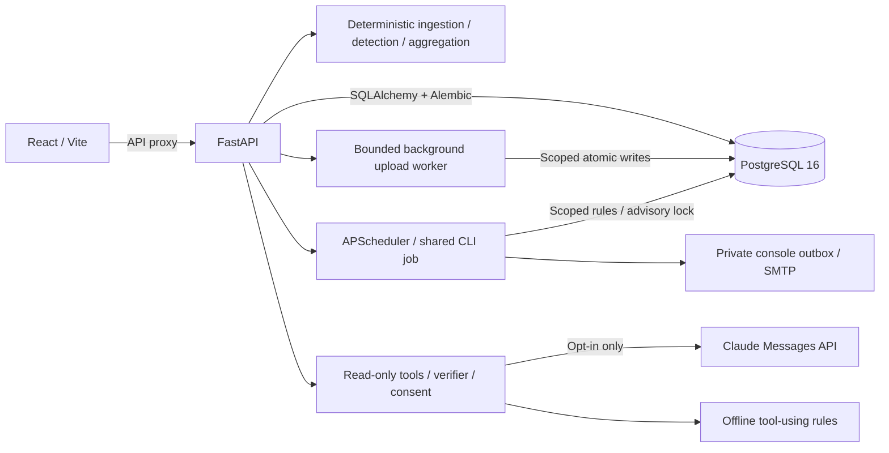

# SubTrack

AI-powered subscription and recurring payment manager for uploaded or synthetic INR transactions.
**Current delivery: Phase 6 grounded chat and optional merchant-category suggestions.**
Register, upload a CSV, review detections, explore spending and manage your preferences in the UI.
Review deterministic savings suggestions and inspect delivered alerts. The offline assistant uses your data through read-only tools. One-click demo seeding remains Phase 7.
See [PROJECT_INFO.md](PROJECT_INFO.md) for the agent handoff, specification, phase gates, and verification log.

## Prerequisites and startup

- Docker Engine/Desktop with Compose v2 supporting `up --wait`.
- GNU Make (optional: use the equivalent Docker commands below).
- Python 3.11+ for `scripts/verify_stack.py`.

From the repository root:

```sh
cp .env.example .env
make dev
make verify
make test
make lint
```

PowerShell without Make:

```powershell
Copy-Item .env.example .env
docker compose up --build --wait
python scripts/verify_stack.py
docker compose run --rm --no-deps api pytest -q
docker compose run --rm --no-deps api ruff check .
docker compose run --rm --no-deps web npm test -- --run
docker compose run --rm --no-deps web npm run lint
docker compose run --rm --no-deps web npm run build
```

Web: [localhost:5173](http://localhost:5173). API docs: [localhost:8000/docs](http://localhost:8000/docs).
The React app calls the real API through Vite's `/api` proxy.
PostgreSQL is internal to Compose and persists in a named volume. API startup runs Alembic.
`docker compose down` stops services without deleting database data.

`make seed` is reserved for Phase 7 and currently exits with an explicit not-implemented error.
Authentication, PostgreSQL persistence, background CSV uploads and business APIs are available.
Recommendations, a daily scheduler, console outbox and optional SMTP delivery are available. Grounded offline chat and opt-in Claude are available; demo seeding remains Phase 7.

## Frontend development and verification

Node.js 22+ and npm are required for local frontend development and browser tests. Compose includes
the web runtime; a local npm install is only needed for local scripts and Playwright.

```sh
cd frontend
npm ci
npm run dev
npm test -- --run
npm run lint
npm run typecheck
npm run build
npm audit --audit-level=low
node node_modules/@playwright/test/cli.js install chromium
cd ..
make dev
make e2e
```

On Linux, use `install --with-deps chromium` to install browser system dependencies. On Windows use
`npm.cmd` when PowerShell blocks npm's script shim. The npm scripts invoke Node entrypoints directly
to support workspace paths containing `&`. `make e2e` runs five Chromium flows against the real
Compose services, with fresh synthetic accounts; it does not mock the API. Set `E2E_BASE_URL` to
test a different local stack. Test accounts are deleted by successful runs. Failed runs can leave
synthetic accounts for investigation; remove them through Settings. Reports/traces are ignored and
must be treated as private because browser traces can contain short-lived test tokens.

`make types` (or `cd frontend && npm run types`) generates `src/api/schema.ts` from
`backend/openapi/openapi.json` with openapi-typescript. Do not edit generated types. `make test`
checks both the backend OpenAPI export and TypeScript drift; the frontend build also checks drift.
The thin openapi-fetch client uses these generated paths and schemas. In Compose the schema is
mounted read-only at `/contract`; `SUBTRACK_SCHEMA` overrides its location for generation only.

`VITE_API_BASE_URL` defaults to `/api/v1`; `VITE_API_PROXY_TARGET` is the server-only Vite proxy
destination. Do not put secrets in `VITE_*` variables. Compose enables `VITE_USE_POLLING=true` for
reliable source updates on Windows Docker bind mounts. Restart/rebuild after changing Vite config.

Access tokens stay in memory with a per-tab sessionStorage fallback. Logout, expiry and protected
401 responses clear the token and Query cache. This allows tab reloads but remains vulnerable to
XSS; uploaded/server text is never rendered as HTML. No refresh token exists. Money is displayed
from API decimal strings with Indian grouping. Charts use BigInt-based dimensionless coordinates;
tooltips, legends and table alternatives retain exact API strings. The browser computes no totals,
projections or savings. Amount sorting is performed by the API.

The UI includes keyboard-operated native dialogs, visible focus, a skip link, dark/light tokens,
and chart data-table alternatives. Vitest uses MSW responses typed from the generated contract;
axe checks structural accessibility in jsdom and full browser checks cover contrast as well.
Screenshots with synthetic data are in [docs/screenshots](docs/screenshots). Design decisions and
verification evidence are recorded in [PROJECT_INFO.md](PROJECT_INFO.md).

## Backend API and upload flow

The complete contract is checked in at [openapi.json](backend/openapi/openapi.json), with a readable
[endpoint summary](backend/openapi/SUMMARY.md). `make openapi` regenerates both from the application;
`make test` checks they are current. Swagger UI is at `/docs`.

1. Register with `POST /api/v1/auth/register`; log in with `POST /api/v1/auth/login`.
2. Send `Authorization: Bearer <access_token>` for every business endpoint.
3. `POST /api/v1/uploads/preview` with multipart `file` returns delimiter, detected date formats,
   safe preview rows, suggested mapping and capped row warnings. It creates no database records.
4. Confirm the mapping, then `POST /api/v1/uploads` with multipart `file` and `mapping`, a JSON
   object encoded as a form string. Example mapping:
   `{"date":"date","description":"description","amount":"amount","type":"type"}`.
5. The upload returns **202 pending**. Poll `GET /api/v1/uploads/{id}` for `stage`, processed/total
   rows, inserted/duplicate/malformed counts, and `done` or `failed`. Stages reflect real worker
   activity: parsing, waiting for user lock, ingesting, detecting, done. Financial writes commit
   atomically; a failed upload has no partial transaction/subscription/charge-link changes.
6. Read `/subscriptions`, `/subscriptions/{id}`, `/summary?period=month|year`,
   `/summary/trend?months=12` and `/renewals/upcoming?days=30`. Lists use limit/offset and totals.
7. Use `PATCH /subscriptions/{id}` for confirmation/status/category/last-used decisions,
   `GET/PUT /budget`, `GET/PUT /settings/alerts`, and the unconfirmed category routes.
8. `DELETE /api/v1/me/data` permanently deletes the account and all owned records in one transaction.
   The caller's tokens stop working; other users are unaffected.

Money is always a decimal string (e.g. `"119.00"`), never a JSON float. Budget input must be a
nonnegative decimal string with at most two decimal places. Summary totals project all active
recurring products, with subscriptions and fixed bills shown separately. Weekly projection uses
52 charges/year, quarterly 4, yearly 1; monthly equivalent is annual/12, rounded once at aggregation.
Trend values are actual linked charges, including historical charges for subsequently cancelled
products. No usage is inferred from payments. Overdue renewals roll forward and retain uncertainty.

Only INR is accepted by upload endpoints in this phase, including FX amounts already converted to
INR. Other currencies are explicitly rejected instead of added to INR totals. The pure detector
keeps currency groups separate, but multi-currency business reporting is not implemented.

CSV files are limited to 5 MB/50,000 parsed records. The HTTP multipart envelope has a further
64 KiB allowance. Malformed-row warnings are capped at 100 while counts remain complete.
Broken quoting retains preceding valid records and reports the unreadable remainder as one
malformed record; subsequent rows cannot be safely recovered. Raw descriptions stay untouched
in PostgreSQL; previews and charge responses neutralize spreadsheet formula prefixes.

Passwords require 12+ characters, three character classes and at most 72 UTF-8 bytes. bcrypt hashes
are stored, not passwords. JWT access tokens expire after 30 minutes by default and require the
configured issuer/audience. Register/login use an in-memory per-client-address sliding-window limit,
including malformed requests; login failures do not reveal account existence.

The worker queue is bounded and in-process (single API process). Interrupted pending/processing
jobs are marked failed at startup for safe re-upload. A durable job queue and multi-process/global
rate limiting are not implemented. Per-user PostgreSQL locks serialize work and user decisions;
another upload can still queue while detection runs. DB uniqueness handles concurrent duplicates.

Generic merchant categories need user confirmation. No LLM calls are made in Phase 5.
Recommendation decisions and user category overrides survive re-upload and regeneration.

## Recommendations and notifications

`GET /api/v1/recommendations` supports status/type filters and pagination; PATCH accepts
`{"action":"accept"}` or `{"action":"dismiss"}`. Acceptance records review intent and never
changes subscription status. Only an explicit subscription cancellation does that. Disappearing
conditions become `resolved`. Decisions persist for unchanged facts, including after reappearance;
changed members, cent amounts, cadence, categories, thresholds or user signals can reopen review.

Duplicate groups cover music, streaming and cloud subscriptions. Estimated monthly saving is the
sum of every member except the most expensive, using Decimal and rounding once. Fixed bills,
cancelled and dismissed plans are excluded. `GET /summary/savings` sums open duplicate estimates
server-side. High-cost and price-increase suggestions have **no saving estimate**; price changes
expose extra monthly cost separately. Possibly-unused suggestions require a user-provided old
last-used date. All messages are advisory deterministic templates; payments never prove usage.

Set an explicit notification email, enabled flag and lead time (1–30 days) in Settings. Blank
email means skipped, even if the login email exists. `GET /alerts` and `/alerts/{id}` expose
scoped delivery states and safe failure reasons. Settings shows the actual notifier mode.
No endpoint triggers a job or sends email directly.

```sh
make run-alerts                       # Current date in APP_TIMEZONE
make run-alerts AS_OF=2026-10-18       # Reproducible simulated clock for synthetic data
make outbox                          # Export dev MIME files to ignored var/outbox/
```

For a demo, upload the sample CSV, configure a notification email and choose an explicit date
three days before an eligible subscription's **known** next renewal. Run the job, inspect the
Settings delivery panel and exported `.eml`, then run again: the event has one outbox artifact.
Lower the budget below the API's monthly-equivalent total and run again for a budget email.
Use only synthetic data and a console notifier for simulated historical dates.

APScheduler runs daily at the configured local time; the CLI invokes the same job. A PostgreSQL
advisory lock serializes overlapping runs. Renewal identity includes subscription and renewal date;
lead-time changes update unsent schedules. Fixed bills, uncertain stopped plans and past renewals
are excluded. The job uses known persisted dates; upload fresh statements to refresh predictions.
Budget checks reuse all recurring spend (including fixed bills), with at most one sent event per
user/calendar month in the application timezone. Cleared overages suppress unsent mail.

ConsoleNotifier creates HTML/plaintext MIME emails, autoescaping untrusted merchant text. Atomic
publication yields one `.eml` per alert UUID, including crash recovery before database confirmation.
The persisted delivery snapshot preserves the original email when preferences later change.
SMTP uses TLS options, validated recipients, bounded exponential retries and stable Message-ID.
**SMTP is at-least-once:** a crash after server acceptance but before the database commit may
produce another message. There is no exactly-once SMTP claim. Ordinary failures leave `sent_at`
empty; retry exhaustion is terminal and visible. Retries run when the job next checks, not in a
separate continuously polling queue. Application logs contain IDs/counts, never email bodies,
addresses, financial amounts or transport exception details.

The scheduler is in-process and supported with one API instance; this is not a distributed queue.
Dev mail persists in Docker's `outbox_data` volume, isolated by user UUID. Account deletion purges
those dev copies; previously exported files and delivered SMTP inbox copies cannot be recalled.
Do not commit or share outbox files containing uploaded financial data. No LLM phrasing of recommendations/emails, push delivery or demo-data endpoint is implemented.

## Grounded chat and category suggestions

Open **Ask SubTrack** from any signed-in page. The default is honestly labelled:
“Offline demo assistant — answers come from your data using built-in rules; no external AI.”
FakeLLM routes recognized questions to the same read-only tools as the live provider and templates
actual returned values. It contains no fixture figures. Unrecognized requests say the information
is unavailable. No network or API key is needed for the offline assistant.

For live mode set `LLM_PROVIDER=anthropic`, `LLM_API_KEY` and an available `LLM_MODEL`, then restart
the API. Unknown providers or missing live configuration fail startup with a safe error; there is
no silent fallback. The only live adapter implements Claude's
[Messages SSE protocol](https://platform.claude.com/docs/en/build-with-claude/streaming) with the
already pinned httpx dependency. No second provider or additional SDK was introduced.

Each user's live opt-in defaults **off**. The drawer discloses external sharing and requires an
explicit checked consent before a live message. Users can withdraw consent. Claude receives the
redacted question, bounded recent chat history, system/tool instructions and scoped tool results
(subscription names, categories, amounts, dates and counts). Email addresses, token patterns,
account IDs and raw transaction descriptions are excluded. Do not type private personal material
into chat; automated redaction is not a general-purpose PII classifier. The server checks consent
before every provider round. In offline mode no data leaves for an external AI.

`POST /api/v1/chat` accepts only `message` (up to 2000 characters) and an optional owned
`conversation_id`. Authenticated fetch reads SSE **status**, **final** and **error** events.
Tool statuses stream live; ALL model text is buffered. There are no unverified token events.
The final contains answer text, `verified`, consulted tool names and a conversation UUID.
OpenAPI includes `x-sse-events` with the generated event schemas. The drawer shows data-only
fallbacks clearly when verification fails, renders plain text, and supports Stop, history paging,
clear history, Escape and focus restoration. No HTML or markdown execution is used.

Seven strict tools: list_subscriptions, spend_summary, upcoming_renewals, compare_to_budget,
get_recommendations, subscription_detail and potential_savings. Auth supplies identity; tools
reject model user IDs/extra arguments. PostgreSQL read-only transactions enforce no writes.
Lists cap at 30 items with truncation metadata; results cap at 60 KB. Untrusted merchant strings
are bounded, control-cleaned and explicitly wrapped as data. Ambiguous merchants return products
to choose from. Summary/insight/renewal functions are shared with the existing business API.
Five tool rounds (at most seven calls each) precede a forced final response; total/per-call time
limits, one in-flight turn, capped history and per-user request caps bound work. Caps are in-memory
and reset on restart; this remains a single-instance development architecture.

The server extracts currency/decimal figures, percentages, ISO/common numeric or written-month
dates, numeric counts and English counts outside verbatim quoted merchant names. Indian grouping is normalized;
relative today/tomorrow/yesterday dates use that turn's explicit tool clock. Values must match
THIS turn's typed tool figures. User messages, old history and numeric merchant text cannot
authorize a figure. Unsupported numeric notation is blocked, not guessed. On mismatch the model
answer is withheld, `verified=false` is recorded and a deterministic data fallback is returned.
The adversarial FakeLLM test proves a fabricated figure never reaches the stream.

**Limit:** this verifies figure provenance, not semantic correctness. A model can associate a real
value with the wrong merchant or make a wrong prose claim. English number-word parsing and date
formats are bounded, not a universal natural-language proof; unsupported phrasing can cause safe
false rejections. Review underlying subscriptions. The assistant has no action/SQL/write tools,
provides no regulated financial advice, and never performs financial arithmetic.

History stores successful user/assistant pairs atomically plus tool name, validated arguments,
result size and digest (not raw tool output). Failed/cancelled turns store no partial pair.
`GET /chat/history` is scoped/paginated; `DELETE /chat/history` clears the caller's history.
Delete-my-data cascades chat rows. Logs contain IDs/counts, never messages or provider responses.
`GET/PUT /chat/config` exposes provider mode, disclosure and per-user opt-in, never a key.

In Categories, **Request category suggestion** is explicit. With live consent only the normalized
merchant name and a fixed enumerated category schema leave the system. Valid suggestions are
cached once per merchant/user with source llm and confirmed=false; subscriptions stay unchanged.
A user choice always wins. Offline mode, opt-out, timeout or failure leave manual selection usable;
failed attempts are cached to avoid repeated provider requests. Existing confirmed/rule-known
merchants are not sent. Recommendations and alert emails keep deterministic wording.

```sh
make chat-eval           # 18 independent-expectation questions; default offline, real PostgreSQL
make chat-eval-live      # Optional paid/network run; requires live env config, never run by CI
make e2e                # Real Compose UI; temporarily freezes API clock to synthetic truth date
```

The live target prints pass/fail and verifier-block states for the same known-answer questions;
it is **not run** in the recorded default verification. Regular tests force offline mode even
when a developer has a live key configured; the live adapter is exercised against a local HTTP
server only. `make e2e` uses `scripts/run_e2e.py` to set APP_TEST_AS_OF for the API and restores the
normal clock in finally. Use it on a local synthetic test stack; leave this variable empty in
normal operation. Test fixtures remain fixed as of 2026-10-18. No live network calls run in CI.

## Local development without Docker

The reproducible runtime is Linux/Python 3.12 in Docker. A local PostgreSQL 16 instance is required
for migrations and tests, and the test role must have CREATEDB permission for isolated test databases.
On Linux/Python 3.12 install the hash lock; native Windows contributors should use Docker (the lock
includes Linux uvloop). `requirements.in` is the source for regenerating platform-specific locks.

```sh
python -m venv .venv
# Activate the venv for your operating system.
python -m pip install --require-hashes -r backend/requirements.lock
cd backend
python -m pytest -q
ruff check .
# Export DATABASE_URL and JWT_SECRET (32+ random characters) before running:
alembic upgrade head
uvicorn app.main:app --reload
```

In a second terminal:

```sh
cd frontend
npm ci
npm test -- --run
npm run lint
npm run build
npm run dev
```

Without `VITE_API_PROXY_TARGET`, Vite proxies to `http://localhost:8000` for local development.
The root `.env` is used by Compose; when launching directly from `backend`, export environment
variables in your shell (or provide a backend `.env`, which is gitignored).

## Configuration

| Variable | Purpose |
| --- | --- |
| `POSTGRES_DB`, `POSTGRES_USER`, `POSTGRES_PASSWORD` | Compose database initialization |
| `DATABASE_URL` | SQLAlchemy connection URL using psycopg; match database credentials |
| `WEB_ORIGIN` | Single allowed browser origin; update if web port changes |
| `API_PORT`, `WEB_PORT` | Localhost-only published ports |
| `VITE_API_BASE_URL` | Browser API prefix, defaults to `/api/v1` |
| `VITE_API_PROXY_TARGET` | Server-side proxy target; `api:8000` in Compose, localhost directly |
| `JWT_SECRET` | Required HS256 signing secret, at least 32 random characters |
| `JWT_ACCESS_MINUTES`, `JWT_ISSUER`, `JWT_AUDIENCE` | Access token expiry (default 30 minutes), issuer/audience |
| `BCRYPT_ROUNDS` | bcrypt cost, default 12; tests override to 4 in isolated test settings |
| `AUTH_REGISTER_LIMIT`, `AUTH_LOGIN_LIMIT`, `AUTH_WINDOW_SECONDS` | Per-IP auth limits, defaults 5/10 per 60 seconds |
| `APP_TIMEZONE` | Application clock timezone, default Asia/Kolkata; tests override the clock dependency |
| `UPLOAD_WORKERS`, `UPLOAD_QUEUE_LIMIT` | Background workers / outstanding-job capacity, defaults 2 / 8 |
| `LLM_PROVIDER` | `fake` (offline default) or `anthropic` (only live adapter) |
| `LLM_API_KEY`, `LLM_MODEL` | Live Claude credentials/model ID; both required in live mode, environment only |
| `LLM_BASE_URL` | Claude API origin, defaults to `https://api.anthropic.com`; local HTTP tests inject a loopback server |
| `LLM_MAX_TOKENS` | Maximum provider output tokens per call, default 1024 |
| `LLM_TIMEOUT_SECONDS`, `LLM_RETRIES` | Per-call time limit (20 seconds), transient-only retry count (2) |
| `CHAT_TIMEOUT_SECONDS`, `CHAT_HISTORY_WINDOW` | Whole-turn budget (60 seconds), recent history messages (8) |
| `CHAT_MINUTE_LIMIT`, `CHAT_DAILY_LIMIT` | Per-user process-local caps: 10/minute, 100/rolling 24 hours |
| `APP_TEST_AS_OF` | Empty normally; explicit ISO date for synthetic browser tests only |
| `HIGH_COST_YEARLY_INR`, `HIGH_COST_SHARE` | Advisory yearly threshold (12000), or share (0.35) above the median; strict greater-than comparisons |
| `UNUSED_DAYS` | Review only user-marked last use older than this many days, default 60 |
| `SCHEDULER_ENABLED` | Start daily scheduler with API, default true |
| `ALERT_JOB_HOUR`, `ALERT_JOB_MINUTE` | Daily local job time in `APP_TIMEZONE`, default 09:00 |
| `ALERT_MAX_ATTEMPTS`, `ALERT_RETRY_SECONDS` | Bounded attempts (3), exponential retry base (300 seconds), checked on the next job run |
| `NOTIFIER_PROVIDER` | `console` (default private outbox) or `smtp` |
| `OUTBOX_DIR` | Native default `var/outbox`; Docker image uses `/var/subtrack/outbox` on a named volume |
| `SMTP_HOST`, `SMTP_PORT`, `SMTP_FROM` | SMTP server, port (587), sender; empty sender uses demo `subtrack@example.org` |
| `SMTP_SECURITY`, `SMTP_TIMEOUT_SECONDS` | `starttls` (default), `tls`, or `none` for local tests; timeout 10 seconds |
| `SMTP_USERNAME`, `SMTP_PASSWORD` | Optional SMTP authentication, environment only |

All `VITE_*` variables are public: never put secrets in them. The example credentials are for local use.
The development images are not a production deployment configuration.

## Architecture



Chat passes all answer figures through a server-side verifier before sending answer text. The LLM must never compute detection or spending figures.
Money must use Decimal and PostgreSQL NUMERIC, and model tools must derive identity from authentication.

## Verification and limitations

The CI workflow installs dependencies, runs backend/frontend checks, boots all three services,
and verifies web delivery plus database-backed readiness both directly and through the web proxy.
The repository is published to GitHub with `origin/master` tracking configured. Hosted results are
available in [GitHub Actions](https://github.com/devendrarajsingh07/AI-Powered-Subscription-Recurring-Payment-Manager/actions).
The first hosted run passed the real browser flow but exposed a Linux cache-permissions issue in
Ruff. Container tool caches now live under `/tmp`, so host-owned/read-only source mounts are supported.

The real Compose stack boots successfully and `make verify` passes through both API and web proxy.
Docker Desktop, GNU Make, and Python 3.12 have been installed on the development machine;
reopen terminals if their PATH predates installation. The handoff lists the installed paths.
Current verification counts and hosted CI evidence are recorded in
[PROJECT_INFO.md](PROJECT_INFO.md). The suite runs against PostgreSQL 16, including migrations,
concurrent regeneration/delivery, SMTP against a local test server, API isolation and deletion.
Browser tests cover the real upload, recommendation acceptance, outbox delivery and budget flow.
One upstream Starlette/AnyIO deprecation warning remains. Synthetic browser screenshots are
committed under `docs/screenshots/`; the complete three-minute demo script remains Phase 7.

## Detection and evaluation

```sh
make sample      # Regenerate reproducible synthetic CSV and independent labels
make evaluate    # Precision/recall/F1 and a nonzero exit on quality regression
make test        # Backend, evaluation, and frontend tests
```

Equivalent commands from `backend`: `python scripts/gen_sample_data.py` and
`python scripts/evaluate_detector.py --json-output data/evaluation_report.json`.

| Dataset | TP | FP | FN | Precision | Recall | F1 |
| --- | ---: | ---: | ---: | ---: | ---: | ---: |
| Synthetic seed 42, 399 transactions | 16 | 0 | 0 | 1.0000 | 1.0000 | 1.0000 |
| Handwritten Withdrawal/Deposit export | 3 | 0 | 0 | 1.0000 | 1.0000 | 1.0000 |
| Handwritten Debit/Credit export | 5 | 0 | 0 | 1.0000 | 1.0000 | 1.0000 |

Metrics count recurring products, including separately labelled fixed bills. Synthetic truth
contains 12 subscription products and 4 fixed bills. Handwritten fixtures are independently
authored bank-shaped samples, not real customer statements. Twenty additional random seeds and
month-boundary/leap-day histories pass in pytest. These results do not establish real-bank accuracy.
An initial Notion alias mismatch was identified and fixed before the reported run.

Normalization removes rails, references, city/noise tokens and punctuation, applies aliases,
and preserves raw descriptions. The detector groups debits by normalized merchant and currency,
classifies median intervals (7±1, 30±4, 91±6, 365±10 days), requires >=70% regular intervals and
population amount CV <=15%. Minimum evidence: 3 charges, or 2 for yearly plans. It tries a coherent
full history first to retain price changes, then tests amount clusters for overlapping products.
All money, statistics, and confidence use Decimal. Confidence blends 50% regularity, 30% amount
stability, and 20% evidence count, with a yearly confidence reduction.

Renewals use nominal intervals and roll forward to the explicit `as_of` date. Two missed cycles
set `possibly_cancelled`; they never change a user's subscription status automatically. Latest
amount >prior median by >5% yields a price-increase signal. Unknown categories require confirmation.
No LLM is called by detection or parsing. CSV limits, mapping, malformed-row reporting, raw-value
preservation, safe display and database upload idempotency are tested against PostgreSQL.

Known limitations: nominal intervals approximate calendar billing dates; first-two-token unknown
merchant grouping can merge unrelated merchants; near-identical product prices may be inseparable;
large price changes can exceed the stability threshold; many missing charges can lower regularity
below threshold; non-Latin merchant descriptions need a later normalization fallback. Unknown-merchant
category suggestions are explicit opt-in requests; they remain unconfirmed and do not change
subscription categories until the user accepts them. Offline mode makes no category suggestion.
Fixtures are fixed as of
2026-10-18; generator `--as-of` and detector's explicit clock support reproducible newer demos.

## Privacy

This project is for demo/educational use. Use only synthetic fixtures in this repository.
Use local synthetic CSVs to exercise the upload API. Do not add personal statements, API keys, `.env`,
or database dumps to version control. Settings includes typed confirmation for complete account/data
deletion and shows the returned deletion counts after logout. Request/worker logs omit raw descriptions, amounts, credentials and SQL
bind values; Uvicorn access logs are disabled to avoid logging user-controlled query strings.

