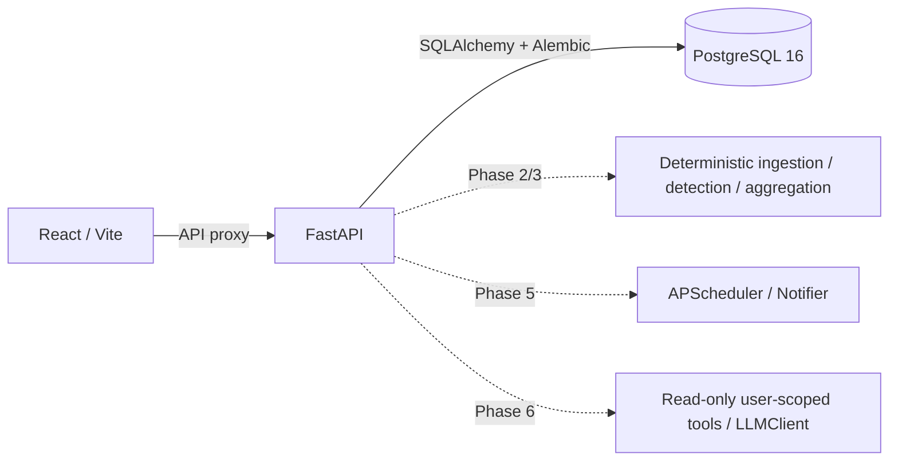

# SubTrack

AI-powered subscription and recurring payment manager for uploaded or synthetic INR transactions.
**Current delivery: Phases 1 and 2 verified. The application is not yet demo-ready.**
See [PROJECT_INFO.md](PROJECT_INFO.md) for the agent handoff, specification, phase gates, and verification log.

## Prerequisites and startup

- Docker Engine/Desktop with Compose v2 supporting `up --wait`.
- GNU Make (optional: use the equivalent Docker commands below).
- Python 3.11+ for `scripts/verify_stack.py`.

From the repository root:

```sh
cp .env.example .env
make dev
make verify
make test
make lint
```

PowerShell without Make:

```powershell
Copy-Item .env.example .env
docker compose up --build --wait
python scripts/verify_stack.py
docker compose run --rm --no-deps api pytest -q
docker compose run --rm --no-deps api ruff check .
docker compose run --rm --no-deps web npm test -- --run
docker compose run --rm --no-deps web npm run lint
docker compose run --rm --no-deps web npm run build
```

Web: [localhost:5173](http://localhost:5173). API docs: [localhost:8000/docs](http://localhost:8000/docs).
The web page queries the real API readiness endpoint through Vite's `/api` proxy.
PostgreSQL is internal to Compose and persists in a named volume. API startup runs Alembic.
`docker compose down` stops services without deleting database data.

`make seed` is reserved for Phase 7 and currently exits with an explicit not-implemented error.
Synthetic CSV data and the tested detection core are available. Authentication, upload APIs,
database persistence, recommendations, alerts, chat, and demo seeding remain to be implemented.

## Local development without Docker

Install Python 3.11+ and Node 22+. A local PostgreSQL 16 instance is needed for readiness and migrations.

```sh
python -m venv .venv
# Activate the venv for your operating system.
python -m pip install -r backend/requirements.txt
cd backend
python -m pytest -q
ruff check .
# Set DATABASE_URL for your local PostgreSQL instance before running:
alembic upgrade head
uvicorn app.main:app --reload
```

In a second terminal:

```sh
cd frontend
npm ci
npm test -- --run
npm run lint
npm run build
npm run dev
```

Without `VITE_API_PROXY_TARGET`, Vite proxies to `http://localhost:8000` for local development.
The root `.env` is used by Compose; when launching directly from `backend`, export environment
variables in your shell (or provide a backend `.env`, which is gitignored).

## Configuration

| Variable | Purpose |
| --- | --- |
| `POSTGRES_DB`, `POSTGRES_USER`, `POSTGRES_PASSWORD` | Compose database initialization |
| `DATABASE_URL` | SQLAlchemy connection URL using psycopg; match database credentials |
| `WEB_ORIGIN` | Single allowed browser origin; update if web port changes |
| `API_PORT`, `WEB_PORT` | Localhost-only published ports |
| `VITE_API_BASE_URL` | Browser API prefix, defaults to `/api/v1` |
| `VITE_API_PROXY_TARGET` | Server-side proxy target; `api:8000` in Compose, localhost directly |
| `JWT_SECRET` | Reserved for Phase 3; replace example value with a strong random secret |
| `LLM_PROVIDER`, `LLM_API_KEY`, `LLM_MODEL` | Reserved for Phase 6; offline fake planned, live provider undecided |
| `NOTIFIER_PROVIDER`, `SMTP_*` | Reserved for Phase 5; console and SMTP planned |
| `ALERT_LEAD_DAYS`, `HIGH_COST_YEARLY_INR` | Reserved alert/recommendation defaults |

All `VITE_*` variables are public: never put secrets in them. The example credentials are for local use.
The development images are not a production deployment configuration.

## Architecture



Dashed components are planned. The LLM must never compute detection or spending figures.
Money must use Decimal and PostgreSQL NUMERIC, and model tools must derive identity from authentication.

## Verification and limitations

The CI workflow installs dependencies, runs backend/frontend checks, boots all three services,
and verifies web delivery plus database-backed readiness both directly and through the web proxy.
CI has been authored, but no remote run is claimed.

The real Compose stack boots successfully and `make verify` passes through both API and web proxy.
Docker Desktop, GNU Make, and Python 3.12 have been installed on the development machine;
reopen terminals if their PATH predates installation. The handoff lists the installed paths.
Backend: 111 tests pass. Frontend: 2 tests pass. Lint, types, and production build pass.
One upstream Starlette/AnyIO deprecation warning remains. Screenshots and the three-minute
demo script will be added after the real application flow exists.

## Detection and evaluation

```sh
make sample      # Regenerate reproducible synthetic CSV and independent labels
make evaluate    # Precision/recall/F1 and a nonzero exit on quality regression
make test        # Backend, evaluation, and frontend tests
```

Equivalent commands from `backend`: `python scripts/gen_sample_data.py` and
`python scripts/evaluate_detector.py --json-output data/evaluation_report.json`.

| Dataset | TP | FP | FN | Precision | Recall | F1 |
| --- | ---: | ---: | ---: | ---: | ---: | ---: |
| Synthetic seed 42, 399 transactions | 16 | 0 | 0 | 1.0000 | 1.0000 | 1.0000 |
| Handwritten Withdrawal/Deposit export | 3 | 0 | 0 | 1.0000 | 1.0000 | 1.0000 |
| Handwritten Debit/Credit export | 5 | 0 | 0 | 1.0000 | 1.0000 | 1.0000 |

Metrics count recurring products, including separately labelled fixed bills. Synthetic truth
contains 12 subscription products and 4 fixed bills. Handwritten fixtures are independently
authored bank-shaped samples, not real customer statements. Twenty additional random seeds and
month-boundary/leap-day histories pass in pytest. These results do not establish real-bank accuracy.
An initial Notion alias mismatch was identified and fixed before the reported run.

Normalization removes rails, references, city/noise tokens and punctuation, applies aliases,
and preserves raw descriptions. The detector groups debits by normalized merchant and currency,
classifies median intervals (7±1, 30±4, 91±6, 365±10 days), requires >=70% regular intervals and
population amount CV <=15%. Minimum evidence: 3 charges, or 2 for yearly plans. It tries a coherent
full history first to retain price changes, then tests amount clusters for overlapping products.
All money, statistics, and confidence use Decimal. Confidence blends 50% regularity, 30% amount
stability, and 20% evidence count, with a yearly confidence reduction.

Renewals use nominal intervals and roll forward to the explicit `as_of` date. Two missed cycles
set `possibly_cancelled`; they never change a user's subscription status automatically. Latest
amount >prior median by >5% yields a price-increase signal. Unknown categories require confirmation.
No LLM is called by detection or parsing. CSV limits, mapping, malformed-row reporting, raw-value
preservation and safe display parsing are covered, but database upload idempotency is Phase 3.

Known limitations: nominal intervals approximate calendar billing dates; first-two-token unknown
merchant grouping can merge unrelated merchants; near-identical product prices may be inseparable;
large price changes can exceed the stability threshold; many missing charges can lower regularity
below threshold; non-Latin merchant descriptions need a later normalization fallback. Unknown-merchant
LLM category caching and user confirmation are not integrated yet. Fixtures are fixed as of
2026-10-18; generator `--as-of` and detector's explicit clock support reproducible newer demos.

## Privacy

This project is for demo/educational use. Use only synthetic fixtures in this repository.
The API does not accept financial uploads yet. Do not add personal statements, API keys, `.env`,
or database dumps to version control. Delete-my-data support is required before demo completion.

