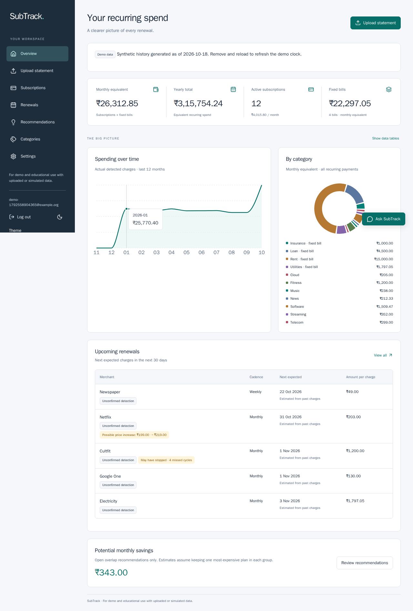
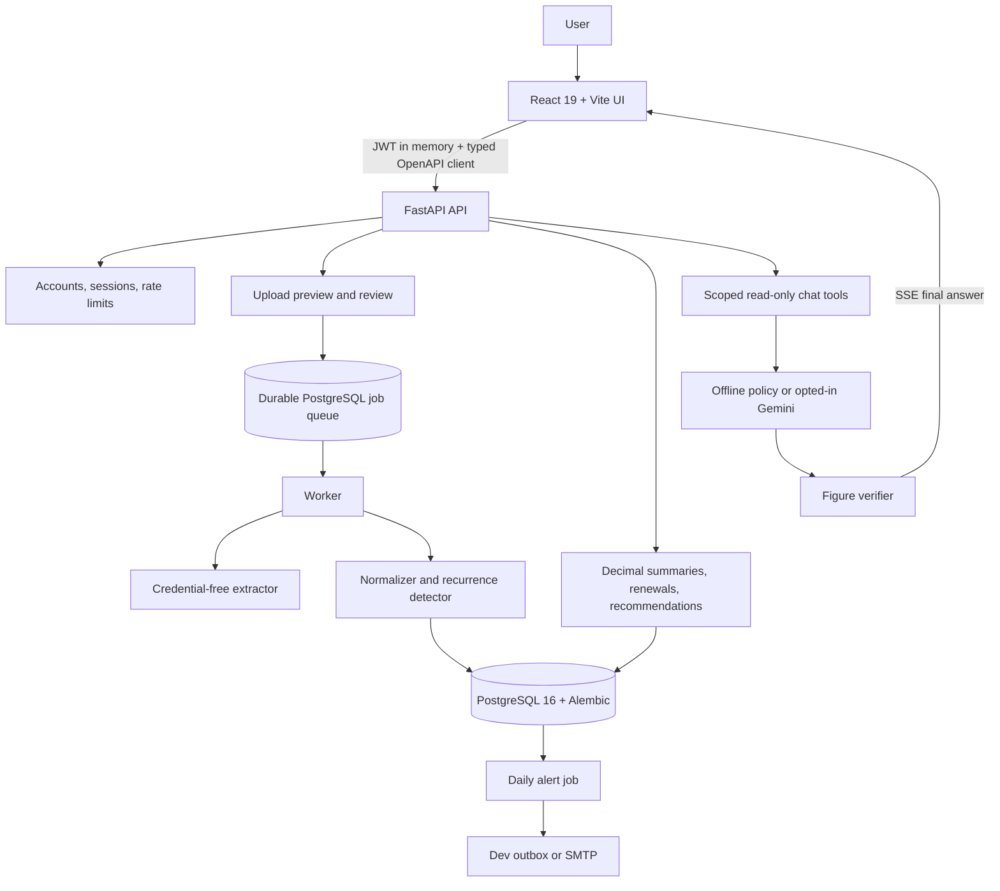
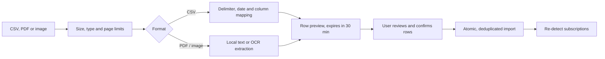
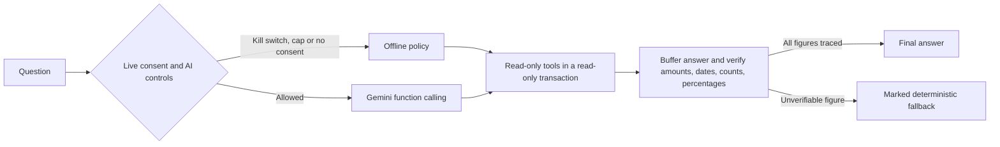
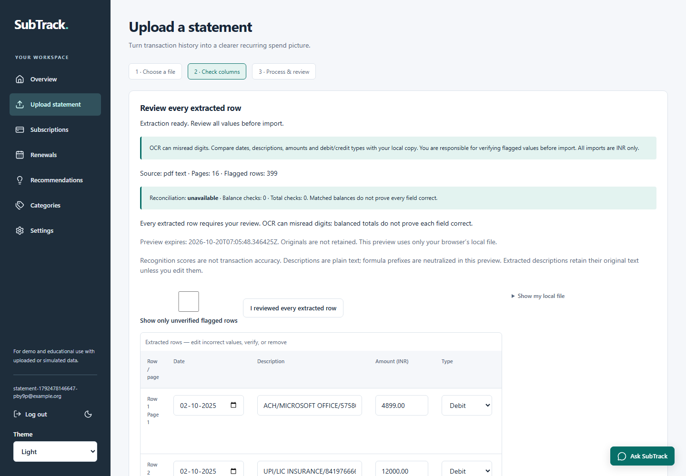
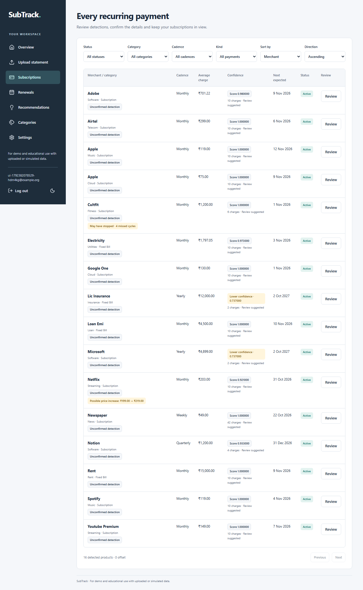
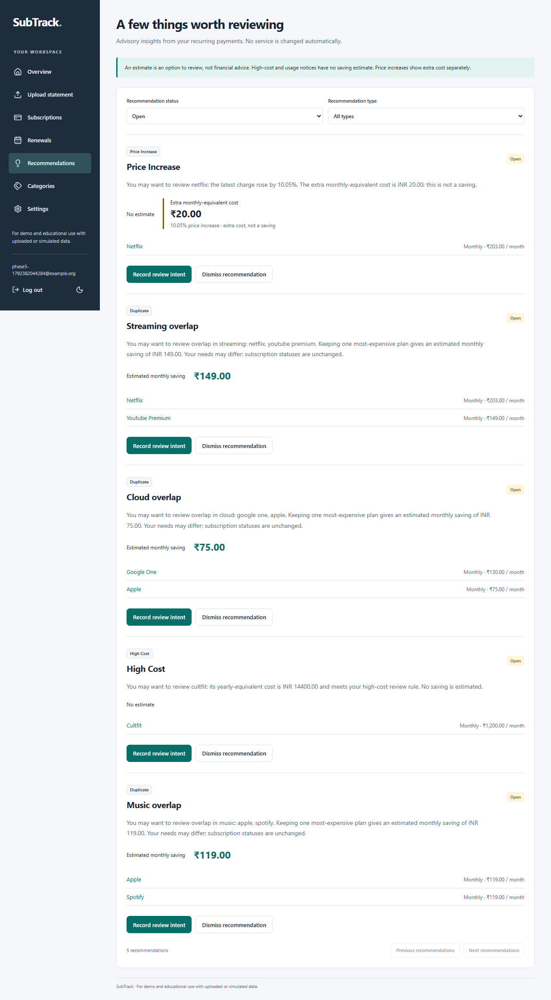
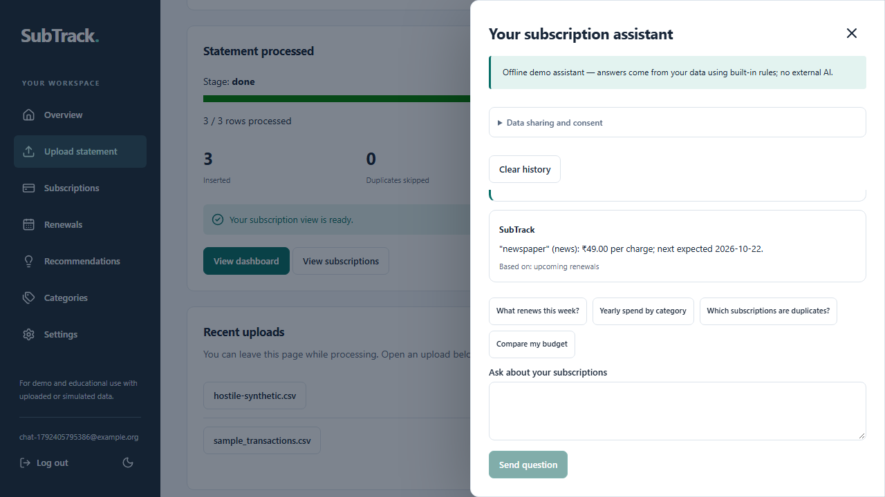
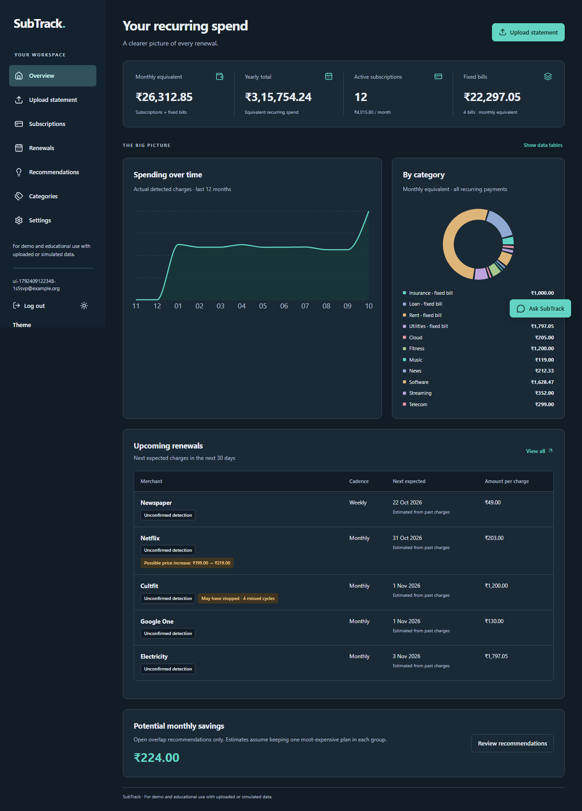

<div align="center">

# 💳 SubTrack

### AI-assisted subscription and recurring payment manager for INR spending

Import bank statements, detect subscriptions and fixed bills, track renewals and budgets, review advisory savings, and ask an assistant whose every figure is verified against your own data.

[](https://github.com/devendrarajsingh07/AI-Powered-Subscription-Recurring-Payment-Manager/actions/workflows/ci.yml)
[](frontend/package.json)
[](frontend/package.json)
[](frontend/package.json)
[](backend/requirements.in)
[](backend/Dockerfile)
[](docker-compose.yml)
[](#-testing-and-quality-checks)

<br />



<br />

**[Live Demo](https://ai-powered-subscription-recurring-p.vercel.app)** · **[Quick Start](#-quick-start)** · **[Features](#-core-features)** · **[Architecture](#-system-architecture)** · **[API](#-api-overview)** · **[Testing](#-testing-and-quality-checks)** · **[Documentation](#-engineering-documentation)**

</div>

---

## 📌 Project Overview

**SubTrack** turns raw INR bank transactions into a clear picture of recurring spending. Deterministic code detects every subscription and fixed bill and computes every number; the AI assistant can only read scoped data through tools, and a server-side verifier blocks any figure it cannot trace back to those tool results.

```text
Statement (CSV / PDF / image) → Extract → Review → Normalize → Detect recurrence
                                                                 ↓
     Dashboard · Renewals · Budget · Savings · Alerts ← Decimal calculations
                                                                 ↓
     Question → Read-only tools → Model (offline or Gemini) → Figure verifier → Answer
```

A clock-relative demo loader feeds synthetic data through the **same real ingestion pipeline**, so the whole product can be explored without a statement. The hosted public demo gives each visitor an isolated, disposable, synthetic-only session.

> [!IMPORTANT]
> **1.0.0 means demo-complete for this scope, not production-ready.** The hosted demo is free and synthetic-only: uploads are disabled and real users are not invited. Do not enter real statements or personal data there. Recommendations and emails are advisory templates, **not financial advice**. Detection accuracy is measured on synthetic and handwritten fixtures only, not on real bank statements.

---

## ✨ Core Features

| Module | What it provides |
|---|---|
| 🏠 **Dashboard** | Monthly and yearly recurring totals, category split, spending trend, upcoming renewals and budget status. |
| 📥 **Statement Import** | CSV preview with column mapping, plus English text/scanned PDF and JPEG/PNG extraction with mandatory editable review. |
| 🔁 **Recurrence Detection** | Weekly, monthly, quarterly and yearly cadence detection with regularity and amount-variation checks and a confidence score. |
| 📋 **Subscriptions** | Filter, sort and review each detected plan, its underlying charges, status, category and price changes. |
| 📅 **Renewals** | Next expected charge projected by calendar month from the last real charge, with missed-cycle and possibly-cancelled flags. |
| 💡 **Recommendations** | Duplicate-plan savings, high-cost and price-increase notices, and possibly-unused plans. Each is explained and advisory only. |
| 🏷️ **Categories** | Confirm or change categories; optional AI suggestions stay unconfirmed until you accept them. |
| 💬 **Assistant** | Streaming chat over seven read-only tools. Unverified numbers never reach the browser. Offline by default, with optional opt-in Gemini. |
| 🔔 **Alerts** | Renewal and monthly budget emails from a PostgreSQL-locked daily job, a private dev outbox or SMTP, and one-click unsubscribe. |
| ⚙️ **Settings & Privacy** | Budget, alert preferences, data export, demo-data removal, problem reports and full account deletion. |
| 🔐 **Accounts** | Strict same-site sessions with rotating refresh cookies, CSRF protection, revocation, email verification and password reset. |
| 🧪 **Public Demo** | One-click isolated demo sessions with no email or password, automatic expiry and no uploads. |

### What the detector looks for

| Rule | Value |
|---|---|
| Cadence tolerance | 7 ± 1 · 30 ± 4 · 91 ± 6 · 365 ± 10 days |
| Minimum charges | 3, or 2 for yearly plans |
| Regularity | at least 70% of intervals within tolerance |
| Amount variation | coefficient of variation at most 0.15 |
| Price increase | latest charge more than 5% above the previous median |
| Fixed bills | rent, loans, insurance and utilities are tracked but excluded from savings |

User confirmations, cancellations and category choices survive re-detection. Missed cycles express uncertainty only and never change a subscription's status on their own.

---

## 🏗️ System Architecture



### Statement ingestion



### Verified assistant answers



### Design principles

- **Money is never a float.** Amounts are `Decimal` in Python and decimal strings over the API; charts derive only dimensionless coordinates.
- **The model never computes figures.** Tools return typed data and the verifier checks every number in the final answer against them. It checks where figures came from, not whether the prose is true.
- **Live AI is opt-in and bounded.** Per-user consent, a global kill switch, daily request and token caps, a reservation before every provider call, and a visible offline fallback.
- **PostgreSQL coordinates everything.** Job leases, rate limits, chat leases, alert locks and AI caps are shared by every API instance; there is no in-process-only state.
- **Production fails closed.** Weak secrets, test clocks, demo loading and the console notifier are refused outside development.
- **Additive migrations only.** Schema changes go through Alembic; `create_all` is never used at runtime.

---

## 🛠️ Technology Stack

| Layer | Technology |
|---|---|
| Frontend | React 19, TypeScript 5.8, Vite 6, React Router, TanStack Query 5 |
| UI and charts | Tailwind CSS 4, Recharts 3, light/dark/system themes |
| API contract | Checked-in OpenAPI JSON with generated TypeScript types (`openapi-typescript`) |
| Backend | FastAPI 0.147, Pydantic Settings, Uvicorn, APScheduler |
| Persistence | PostgreSQL 16, SQLAlchemy 2, Alembic, psycopg 3 |
| Statement extraction | pdfminer.six, pypdf, Pillow, Tesseract/poppler in Docker |
| Authentication | bcrypt, PyJWT, rotating HttpOnly refresh cookies, CSRF tokens |
| AI | Deterministic offline policy by default; optional Gemini REST function calling |
| Email | Jinja2 templates, console outbox or SMTP with TLS, RFC 8058 one-click unsubscribe |
| Testing | pytest on real PostgreSQL, Vitest + MSW, Playwright (Chromium, Firefox, WebKit), axe |
| CI/CD | GitHub Actions (Gitleaks, checks, e2e, same-site auth); opt-in verified release workflow |
| Hosting | Render (API, free tier) · Render PostgreSQL (free tier) · Vercel (frontend) |

Exact versions: [frontend/package.json](frontend/package.json), [backend/requirements.in](backend/requirements.in), and the hash-pinned [backend/requirements.lock](backend/requirements.lock).

---

## 🚀 Quick Start

### Prerequisites

- **Git**, **Docker Desktop/Engine** (running) with Compose v2, and **GNU Make**
- For host-side checks and browser tests: **Python 3.11+**, **Node.js 22+** and npm
- Internet for the first clone, image builds and package installs. After that, the default demo needs no API key, bank connection or SMTP server.

### 1. Clone and configure

```powershell
git clone https://github.com/devendrarajsingh07/AI-Powered-Subscription-Recurring-Payment-Manager.git
Set-Location AI-Powered-Subscription-Recurring-Payment-Manager
Copy-Item .env.example .env
```

On Linux/macOS use `cd` and `cp .env.example .env`. The copied credentials are **development-only**. On PowerShell, quote any path that contains `&`.

### 2. Start the stack and seed demo data

```sh
docker compose up --build --wait
make seed
```

Without Make, the second command is `docker compose exec api python scripts/seed_demo.py`.

### 3. Open the app

| Service | Default URL |
|---|---|
| Frontend | [http://localhost:5173](http://localhost:5173) |
| API health | [http://localhost:8000/api/v1/health](http://localhost:8000/api/v1/health) |
| Swagger API docs | [http://localhost:8000/docs](http://localhost:8000/docs) |

Local development login only, never used on the hosted demo: **subtrack-demo@example.org / SubTrackDemo2026!**. Or register your own empty account and choose **Load demo data**.

Demo data is generated relative to today in `APP_TIMEZONE`, and loading it again is idempotent. Demo and real uploads cannot be mixed in one account. Settings can remove demo data or delete the account entirely.

---

## 🌐 Hosted Demo

| Part | Where |
|---|---|
| Frontend | [ai-powered-subscription-recurring-p.vercel.app](https://ai-powered-subscription-recurring-p.vercel.app) |
| API | [ai-powered-subscription-recurring.onrender.com/api/v1/health](https://ai-powered-subscription-recurring.onrender.com/api/v1/health) |

- Runs the public-demo build (`PUBLIC_DEMO_ONLY=true`): **Start isolated demo** creates a disposable synthetic-only account with no email or password.
- Uploads are disabled, accounts expire automatically, and reloading starts a new session (no refresh cookie is issued cross-site).
- `/api/v1/health` and the frontend's `/version.json` both report the deployed Git commit.
- The free Render instance sleeps when idle, so the first request can take about a minute.

See [Free demo hosting](docs/FREE_DEMO_HOSTING.md) for the deployment setup.

---

## 🔌 API Overview

All business routes live under `/api/v1` and require a bearer access token. The complete contract is in [backend/openapi/openapi.json](backend/openapi/openapi.json) and at `/docs` while the API is running.

| Area | Endpoints |
|---|---|
| Health | `GET /health`, `GET /health/ready` |
| Authentication | `POST /auth/register`, `POST /auth/login`, `POST /auth/refresh`, `POST /auth/csrf`, `POST /auth/logout`, `POST /auth/logout-all`, `GET /auth/me`, `GET /auth/config` |
| Account recovery | `POST /auth/email/request`, `POST /auth/email/confirm`, `POST /auth/password/request`, `POST /auth/password/reset` |
| Public demo | `POST /auth/demo`, `POST /demo/load`, `DELETE /demo/data` |
| Uploads | `POST /uploads/preview`, `GET`/`DELETE /uploads/previews/{id}`, `GET`/`POST /uploads`, `GET /uploads/{id}` |
| Jobs | `GET /jobs`, `GET`/`PATCH /jobs/{id}` |
| Subscriptions | `GET /subscriptions`, `GET`/`PATCH /subscriptions/{id}` |
| Spending | `GET /summary`, `GET /summary/trend`, `GET /summary/savings`, `GET /renewals/upcoming`, `GET`/`PUT /budget` |
| Insights | `GET /recommendations`, `PATCH /recommendations/{id}`, `GET /categories/unconfirmed`, `PATCH /categories/{id}`, `POST /categories/{id}/suggest` |
| Assistant | `POST /chat` (SSE), `GET`/`PUT /chat/config`, `GET`/`DELETE /chat/history` |
| Alerts | `GET /alerts`, `GET /alerts/{id}`, `GET`/`PUT /settings/alerts`, `POST /alerts/unsubscribe` |
| Your data | `GET /me/export`, `DELETE /me/data`, `POST /support/reports` |

Login errors never reveal whether an account exists. Passwords need 12+ characters, three character classes and at most 72 UTF-8 bytes. Operator-only metrics (`/ops/metrics`) are hidden unless a long `OPS_METRICS_TOKEN` is configured.

---

## 📥 Statement Import Limits

| Format | Limits and behaviour |
|---|---|
| CSV | 5 MB, 50,000 rows; amount/type or separate debit/credit columns; delimiter and date format inferred, mapping confirmed by you |
| PDF | 10 MB, 30 pages; English text or scanned; encrypted PDFs use a separate memory-only password field |
| Image | JPEG/PNG, 10 MB, 25 megapixels; clean scans around 200 dpi or better work best |

- Original files and passwords are not kept, and row previews expire after 30 minutes.
- Every extracted row needs your review, even when balances match.
- INR only. Excel, phone photos and handwriting are unsupported or best effort.
- Extraction runs locally in Docker with no cloud OCR, no LLM extraction and no API key. Native Windows parsing is unsupported; use the Linux Docker API.

Details: [Statement import](docs/STATEMENT_IMPORT.md).



---

## 🤖 Offline and Live AI

| Mode | How it works |
|---|---|
| **Offline (default)** | `LLM_PROVIDER=fake`: a deterministic tool-using policy with no network and no hard-coded figures. Says so when information is unavailable. |
| **Live Gemini (opt-in)** | `LLM_PROVIDER=gemini` plus your own `LLM_API_KEY` and `LLM_MODEL` in a private `.env`. Each user must consent separately. |

When live mode is used, only redacted questions, recent history, tool schemas and scoped merchant names, categories, amounts, dates and counts are sent. Raw descriptions, emails, account IDs and tokens are not. Redaction is not a complete PII filter, so do not type personal material.

**Operator controls:**

```sh
make llm-status     # show kill switch and today's usage
make llm-kill       # stop all live calls immediately (offline fallback)
make llm-restore    # re-enable live calls
```

> [!WARNING]
> Read your Gemini API tier's terms before enabling live mode. Google's [unpaid tier](https://ai.google.dev/gemini-api/terms) allows product improvement and human review, so never send personal financial data on it. No live evaluation has been run for this project, and live quality is not measured.

---

## 🔐 Security and Data Integrity

- Access tokens live in memory only. Strict mode uses rotating `Secure`, `HttpOnly`, `SameSite=Strict`, host-only refresh cookies with CSRF protection and server-side revocation.
- Passwords use bcrypt, and account-level login backoff is stored in PostgreSQL.
- Auth rate limits use shared PostgreSQL windows and fail closed if the store is unavailable. `X-Forwarded-For` is ignored unless `TRUSTED_PROXY_HOPS` names the proxies you control.
- Production startup rejects weak or default `JWT_SECRET`, wildcard CORS, test clocks, demo loading and the console notifier.
- The API and web containers run as non-root. Responses set `nosniff`, `no-referrer`, frame denial and a deny-all CSP for data routes.
- Every query is scoped to the signed-in user; chat tools cannot accept a user ID and run in read-only transactions.
- Durable job input is encrypted at rest and bounded; the extractor receives no database or application credentials.
- Retention jobs purge old jobs (7 days), chat (30), alerts (180) and audit records (90). Account deletion purges immediately.
- Emails honour bounce/complaint suppression and signed one-click unsubscribe links.
- Python dependencies are hash-pinned; CI runs full-history Gitleaks, `npm audit` and lockfile checks.

See [Privacy](docs/PRIVACY.md), [Account security](docs/PHASE8_ACCOUNT_SECURITY.md) and [Security incident log](docs/SECURITY_INCIDENT.md).

---

## 🧪 Testing and Quality Checks

| Suite | Scope |
|---|---|
| **Backend: 477 pytest tests** | Real PostgreSQL: auth and sessions, ingestion and extraction, detector evaluation, renewals, insights, alerts, chat grounding and verifier, AI controls, durable queue and crash recovery, public demo, retention, email lifecycle and release tooling |
| **Frontend: 73 Vitest tests** | Components and pages with typed MSW handlers, money formatting, accessibility |
| **Browser e2e** | Playwright against the real Compose stack (never mocked happy paths) in Chromium, Firefox and WebKit, plus axe scans of every page in both themes at 360 px |

```sh
make test       # pytest on PostgreSQL, detector evaluation, OpenAPI drift, Vitest, TS type drift
make lint       # Ruff, ESLint, TypeScript
make e2e        # real-stack Playwright flows
make evaluate   # precision/recall/F1 on synthetic and handwritten fixtures
make chat-eval  # 18 independent known-answer questions (offline)
```

Host browser setup:

```sh
cd frontend
npm ci
node node_modules/@playwright/test/cli.js install chromium firefox webkit
npm run build
cd ..
make e2e
```

Every push runs four CI jobs: **secrets** (Gitleaks), **checks** (lint, tests, audits, Docker stack), **e2e** and **auth-same-site**. Evidence and remaining gaps are tracked in the [Definition of Done](docs/DOD.md).

---

## 📁 Project Structure

```text
AI-Powered-Subscription-Recurring-Payment-Manager/
├── frontend/
│   ├── e2e/                      # Playwright real-stack specs
│   ├── public/
│   ├── src/
│   │   ├── api/                  # Generated OpenAPI types and client
│   │   ├── components/           # Layout, chat drawer, charts, dialogs
│   │   ├── hooks/                # TanStack Query data hooks
│   │   ├── lib/                  # Money formatting and utilities
│   │   └── pages/                # Dashboard, Upload, Subscriptions, Renewals, ...
│   ├── vercel.json
│   └── package.json
├── backend/
│   ├── alembic/                  # Additive database migrations
│   ├── app/
│   │   ├── api/                  # Routes: core, account, chat, lifecycle, ops
│   │   ├── models/               # SQLAlchemy models
│   │   ├── schemas/              # Pydantic request/response models
│   │   ├── services/             # Detector, insights, renewals, chat, LLM, queue, email
│   │   ├── templates/            # Email templates
│   │   ├── durable_worker.py     # Durable job worker
│   │   └── extractor_service.py  # Credential-free statement extractor
│   ├── data/                     # Synthetic fixtures and ground truth
│   ├── openapi/                  # Checked-in API contract
│   ├── scripts/                  # Seed, evaluation, demo server, private checker
│   ├── tests/
│   ├── Dockerfile
│   └── requirements.lock
├── scripts/                      # Stack verification, e2e runner, release, smoke tests
├── docs/                         # Architecture, privacy, runbook, launch gates, screenshots
├── .github/workflows/            # ci.yml, deploy.yml
├── docker-compose.yml
├── Makefile
├── PROJECT_INFO.md               # Current state and handoff notes
├── CHANGELOG.md
└── README.md
```

---

## 🧭 Application Routes

| Route | Purpose |
|---|---|
| `/login`, `/register` | Sign in, register, or start an isolated public demo |
| `/verify-email`, `/reset-password` | Email verification and password recovery |
| `/` | Dashboard |
| `/upload` | Import CSV, PDF or image statements and review rows |
| `/subscriptions` | Detected subscriptions and fixed bills |
| `/renewals` | Upcoming renewals |
| `/recommendations` | Advisory savings and notices |
| `/categories` | Confirm or change categories |
| `/settings` | Budget, alerts, export, demo data and account deletion |
| `/unsubscribe` | One-click email unsubscribe |

<table>
  <tr>
    <td></td>
    <td></td>
  </tr>
  <tr>
    <td></td>
    <td></td>
  </tr>
</table>

---

## ⚙️ Environment Configuration

Main settings are in [.env.example](.env.example); the rest have safe defaults in [config.py](backend/app/config.py). Restart after changing them. Never commit a real `.env`.

| Area | Main variables |
|---|---|
| Runtime | `ENVIRONMENT`, `DEMO_ENABLED`, `PUBLIC_DEMO_ONLY`, `APP_TIMEZONE`, `APP_TEST_AS_OF` |
| Database | `DATABASE_URL` (`postgres://` is accepted and rewritten to `postgresql+psycopg://`), `POSTGRES_*` |
| Auth and sessions | `JWT_SECRET`, `JWT_ACCESS_MINUTES`, `AUTH_SESSION_MODE`, `AUTH_REFRESH_DAYS`, `REGISTRATION_MODE`, `REQUIRE_EMAIL_VERIFICATION`, `API_ORIGIN`, `AUTH_COOKIE_SITE` |
| Rate limits | `AUTH_REGISTER_LIMIT`, `AUTH_LOGIN_LIMIT`, `AUTH_WINDOW_SECONDS`, `AUTH_SESSION_LIMIT`, `ACCOUNT_BACKOFF_THRESHOLD`, `TRUSTED_PROXY_HOPS` |
| Jobs | `JOB_MODE`, `UPLOAD_WORKERS`, `UPLOAD_QUEUE_LIMIT`, `JOB_LEASE_SECONDS`, `JOB_MAX_ATTEMPTS` |
| Retention | `RETAIN_JOB_DAYS`, `RETAIN_CHAT_DAYS`, `RETAIN_ALERT_DAYS`, `RETAIN_AUDIT_DAYS` |
| AI | `LLM_PROVIDER`, `LLM_API_KEY`, `LLM_MODEL`, `LLM_BASE_URL`, `LLM_MAX_TOKENS`, `LLM_KILL_SWITCH`, `CHAT_MINUTE_LIMIT`, `CHAT_DAILY_LIMIT` |
| Alerts and email | `NOTIFIER_PROVIDER`, `SCHEDULER_ENABLED`, `ALERT_JOB_HOUR`, `SMTP_HOST`, `SMTP_PORT`, `SMTP_FROM`, `SMTP_SECURITY` |
| Insights | `HIGH_COST_YEARLY_INR`, `HIGH_COST_SHARE`, `UNUSED_DAYS` |
| Web | `WEB_ORIGIN`, `VITE_API_BASE_URL`, `VITE_API_PROXY_TARGET`, `API_PORT`, `WEB_PORT` |

---

## 🛠️ Troubleshooting

### The stack does not start

1. Start Docker Desktop/Engine and wait until it is healthy.
2. On Windows, restart the terminal after installing Make, Docker or Node so `PATH` updates. PowerShell may need `npm.cmd`.
3. Quote paths containing `&` or spaces: `Set-Location -LiteralPath 'C:/path with & characters'`.
4. On a port conflict, set `API_PORT`/`WEB_PORT` and a matching `WEB_ORIGIN`.

### Database schema is out of date

```sh
make dev     # applies the Alembic head
make verify  # web, API proxy and migration-head readiness
```

Never use `create_all`.

### Hosted API fails with `ModuleNotFoundError: psycopg2`

Older builds needed `DATABASE_URL` to start with `postgresql+psycopg://`. Current builds rewrite `postgres://` and `postgresql://` automatically; redeploy the latest commit.

### Upload failed or demo dates look stale

- A failed upload commits no half-written financial data. Read the progress message and retry.
- For a failed demo load, remove demo data in Settings and load again.
- Demo dates are generated relative to the load day; remove and reload to refresh them. Uploaded history is never shifted.

### No dev email appeared

Check the recipient, alert settings and planned send date in Settings, then run `make run-alerts AS_OF=YYYY-MM-DD` and `make outbox`. Past or possibly-cancelled renewals are skipped on purpose.

---

## 📚 Engineering Documentation

| Document | Purpose |
|---|---|
| [Project Info](PROJECT_INFO.md) | Current state and agent handoff notes |
| [Architecture](docs/ARCHITECTURE.md) | Detection, delivery, verifier and limitations |
| [Demo Script](docs/DEMO.md) | Timed three-minute tour with measured values |
| [Statement Import](docs/STATEMENT_IMPORT.md) | Formats, evaluation, limits and private checker |
| [Privacy](docs/PRIVACY.md) | Data handling, retention, disclosure and deletion |
| [Runbook](docs/RUNBOOK.md) | Operations, AI kill switch, releases and proxy settings |
| [Launch Gates](docs/LAUNCH.md) | What must pass before a real-user beta |
| [Definition of Done](docs/DOD.md) | Evidence table and honest gaps |
| [Phase 8 Plan](docs/PHASE8_PLAN.md) | Implementation decisions for the beta foundation |
| [Free Demo Hosting](docs/FREE_DEMO_HOSTING.md) | Render and Vercel setup |
| [Security Incident](docs/SECURITY_INCIDENT.md) | Credential exposure and rotation record |
| [UI QA](docs/design/QA.md) | State matrix and visual checks |
| [Legal drafts](docs/legal/) | Privacy policy and terms (**drafts, not approved**) |
| [Changelog](CHANGELOG.md) | Release history |

---

## 🗺️ Project Status

| Area | Status |
|---|---|
| Phases 1–7 (core product, statements, assistant, alerts, UI) | ✅ Complete for demo scope |
| Phase 8 code (accounts, durable jobs, rate limits, AI controls, retention, email lifecycle, release pipeline) | ✅ Merged, hosted CI green, deployed to the free demo |
| Phase 8 drills (two API instances on one database, backup restore, load test, ZAP scan) | ⏳ Not yet run |
| Real-user beta | 🚫 Blocked: needs the drills, a backed-up database, real email delivery and approved legal documents |

---

## 🤝 Contributing

1. Create a focused branch for one change.
2. Keep money in `Decimal`, API contracts typed, and migrations additive.
3. Add or update tests for behaviour changes, including independent ground-truth checks.
4. Run `make lint`, `make test` and `make e2e`; regenerate types with `make openapi types` if the API changes.
5. Describe the user-facing impact, verification and limitations in your pull request.

Never commit `.env` files, real statements, outbox copies, keys or browser traces. Use the ignored `private-statements/` folder or a location outside the checkout.

---

## 📄 Assets and Licensing

 ` MIT LICENSE`

---

<div align="center">

### Built to make recurring spending visible, explainable, and verifiable to the last rupee.

Created by [Devendra Raj Singh](https://github.com/devendrarajsingh07)

</div>
