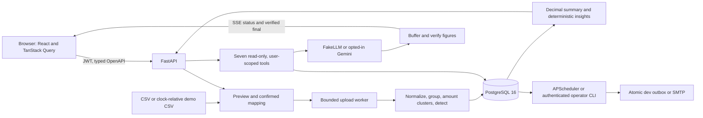

# Architecture and limits

SubTrack 1.0.0 means demo-complete for the seven-phase scope, **not production-ready**.
The Compose deployment is a local dev/demo environment with Vite and API reload enabled.

## Persistence and identity

Alembic migrations own schema creation; startup checks the database against the script head.
Users own uploads, transactions, subscriptions, charge links, category cache, budgets,
recommendations, alerts and chat messages. Composite ownership foreign keys reject cross-user
links; every repository function accepts authenticated user_id. The model never chooses identity.
Passwords use bcrypt, email identity is normalized, and short-lived HS256 JWTs have no refresh token.
The browser uses memory and per-tab sessionStorage; XSS could steal a bearer token. Plain text
rendering, CSP and no raw HTML reduce risk but do not eliminate that trade-off.

Money is Decimal/NUMERIC and API decimal strings. Individual amounts use NUMERIC(12,2);
aggregate recommendation values use NUMERIC(24,2). Annual factors are 52/12/4/1 for
weekly/monthly/quarterly/yearly; round once after aggregation. The frontend formats strings
and BigInt chart coordinates, never financial totals or projections. Fixed bills are tracked
separately and excluded from subscription savings; budgets include both kinds.

Uploads are limited to 5 MB and 50,000 rows, with a separately bounded multipart envelope.
Preview values are formula-safe; stored raw descriptions are unchanged. Broken CSV quoting
preserves preceding complete records and counts the unreadable remainder as one malformed row.
DB uniqueness on user/date/raw description/amount makes repeated and concurrent imports idempotent.
Financial writes commit atomically; progress is separately persisted, and interrupted workers
become failed at startup. Submission policy has a separate PostgreSQL advisory lock, preserving
the ability to queue while another detection holds the user row lock.

## Detection

Lowercase, remove references/digits/punctuation/rail and noise tokens, apply aliases, and keep
meaningful tokens. Ignore credits. Group normalized debits, split amount clusters when a coherent
whole group does not fit. Median intervals: weekly 7±1, monthly 30±4, quarterly 91±6, yearly 365±10.
Require regularity ≥0.7, amount coefficient of variation ≤0.15, three occurrences (two yearly).
Confidence blends regularity 50%, stability 30%, evidence 20%, with reduced yearly confidence.
Latest charge >previous median by >5% yields a price signal. Predict nominal cycles, roll forward,
and label two missed cycles as possibly cancelled without changing user status. User decisions
and category overrides survive re-detection. Unknown category suggestions require confirmation.

## Recommendations

Only active subscriptions participate. Duplicate categories: music, streaming and cloud.
Estimated monthly saving is the sum except the most expensive member, calculated server-side.
High cost is an annual threshold or above-median monthly share; it has no savings estimate.
Price increases show a Decimal percentage and explicitly labelled extra cost, not a saving.
Possibly-unused requires an old user-provided last-used date; payments never establish usage.
Stable subject keys and facts hashes preserve accept/dismiss decisions for unchanged facts;
material changes can reopen review. Disappearing conditions become resolved. Acceptance records
review intent and never cancels a subscription. Messages and emails remain deterministic.

## Alerts and delivery

Daily APScheduler and CLI share one implementation. A PostgreSQL advisory lock serializes jobs.
Renewals include active subscriptions only, excluding fixed bills, uncertain stopped plans and
past renewals. Stable subscription/cycle identity survives lead-time changes. Budget identity is
user/local calendar month; summary code supplies totals, overage and top contributors.
Disabled alerts or no recipient are skipped. Unsent snapshots are reconciled before sending.
Persist claim/attempt/retry deadlines; bounded exponential retries end in a visible failed state.

ConsoleNotifier atomically publishes one MIME file per alert UUID and recovers its receipt if
the process crashes before marking sent. SMTP is **at-least-once** across server acceptance versus
database commit: stable Message-ID is not a guarantee against duplicate inbox delivery. Delivery
snapshots make sent messages reproducible. No bodies, recipients, transaction descriptions or
amounts go to application logs. Console outbox is a development notifier, not a production mailer.

## Chat and Gemini

FakeLLM is an offline pattern-to-tool policy templating actual results, not a generative model
or hard-coded demo answers. Gemini is the single live adapter, explicitly selected by the owner
in Phase 7, replacing Claude. REST streaming uses existing httpx, bounded retries/timeouts and
preserves signed function-call parts between rounds. Local HTTP protocol tests do not establish
live model quality; the live evaluation remains an owner task.

Seven strict tools: list_subscriptions, spend_summary, upcoming_renewals, compare_to_budget,
get_recommendations, subscription_detail, potential_savings. PostgreSQL read-only transactions
also prohibit writes. No SQL/filesystem/network/action tool is exposed. Scope comes from auth;
schemas forbid extra fields. Merchant strings are capped, delimited untrusted data; raw descriptions,
emails, tokens and account IDs never appear in tool output. Ambiguous merchants return candidates.

At most five tool rounds, configurable per-call/total timeout, one in-flight turn per user, minute
and day caps. All model text is buffered; SSE emits live tool statuses then a verified final.
The verifier checks normalized money/decimals/percentages/dates/counts against typed values in
that turn's tool outputs. An unverifiable figure is replaced by a deterministic fallback and
verified=false. Tool metadata includes name, validated args, size/digest, not result bodies.
The verifier proves **figure provenance only**, not prose truth or correct associations. Prompt
instructions support the checks but are not their enforcement. No LLM arithmetic is accepted.

## Demo policy

Demo CSV and independent labels are generated from plan inputs relative to application today,
seed 42. Existing demo loads reuse their recorded as_of; remove and reload to refresh explicitly.
Never shift real data. Real/demo mixing is refused in either direction. Loading uses the normal
parser, worker, detector, persistence, insights and alert planner. Demo provenance is on uploads.
Defaults: budget 100 INR below current recurring total, notification demo@example.org if absent.
Removal restores unchanged defaults, preserves later choices, deletes demo-derived records and,
for the demo-only workspace, chat and private dev outbox. Account deletion removes everything.
Production refuses demo/test-clock/console/adversarial settings; seed is development-only.

## Known limitations and production work

- Precision/recall are measured on synthetic and handwritten fixtures; real-bank accuracy is unmeasured.
- Nominal renewals approximate billing calendars; missing charges or sparse histories can be missed.
- Similar merchant/product prices may merge; large price changes can fail stability; unknown/non-Latin
  descriptions need review. INR only; no FX conversion or multi-currency totals.
- A recurring payment is not proof of use, redundancy, cancellation or suitability of a purchase.
- One API instance: upload pool, scheduler, limiter and chat gate are in-process. No durable queue,
  distributed rate limit, failover or backup/restore operational runbook.
- Figure verification does not verify prose. Offline assistant handles recognized patterns only.
  Automated chat redaction is not a complete PII classifier. External retention follows the live provider.
- SMTP has the send/commit ambiguity described above. Exported files and delivered email cannot be recalled.
- Initial clone/image/package installation needs network; after installation the default demo needs
  no AI service, key, bank connection or SMTP server. Offline builds require pre-cached dependencies/images.
- Browser axe is automated evidence, not a screen-reader certification. Human screen-reader pass pending.
- Production additionally needs TLS/reverse proxy, a production web build/server and strict CSP,
  secret management/rotation, DB backups, monitoring, durable jobs/limits, retention policy, access
  review and deployment-specific security testing. This repository supplies no cloud deployment tooling.
- No stretch features: forecasting, cancellation helper, Gmail parsing, web push or multiple currencies.
