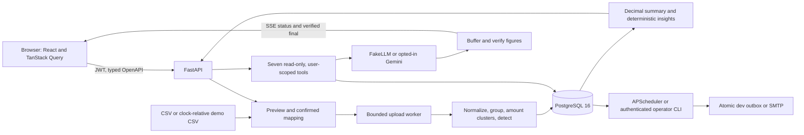

# Architecture and limits

SubTrack 1.0.0 means demo-complete for the seven-phase scope, **not production-ready**.
The Compose deployment is a local dev/demo environment with Vite and API reload enabled.

## Additive statement-import path (Phase 7.5)

PDF/image multipart intake checks size, magic and extension. A user-scoped preview job runs local
extraction through the durable worker and credential-free extractor service in Compose. pypdf
decrypts/copies pages without document-level active content; pdfminer reads positioned text. Scanned pages use poppler at 200 dpi and Tesseract TSV after
grayscale/metadata removal, bounded upscale, median denoise and conservative deskew. Positioned
words share table/line reconstruction. No JavaScript or attachment is executed. Malformed parsers
are bounded by per-page/total deadlines, resource limits and process-group termination.

Preview rows use the existing CSV date/Decimal validators. Running balances use exact debit/credit
equations; opening/closing/debit/credit totals are checked when present. Incomplete coverage is not
called matched. Breaks and neighboring rows are flagged. Every row additionally requires explicit
review, including high-confidence/reconciled text/OCR: confidence cannot establish a correct digit.
Confirmation locks the preview, validates strict edits, excludes unverified rows and queues virtual
CSV through the existing transactional upload/dedupe/detection/insight/alert-planning pipeline.
Repeated confirmation returns the same upload. No subscriptions are inserted directly.

Migration0008 adds upload source_type/excluded_count, owned preview jobs with JSONB row payloads
and 30-minute expiry, and content-free daily usage counters. Confirmation/cancellation clears
payloads immediately; metadata expires; startup/periodic/access cleanup handles abandoned/expired
previews. Account deletion cascades. Original bytes/passwords are transient; review uses a local
browser object URL. Responses containing authenticated data use Cache-Control: no-store.

Compose uses PostgreSQL durable jobs with leases/claim tokens, a separate worker, and a
no-network extractor container with no database credentials and bounded cgroup resources.
The free hosted demo uses its configured inline fallback; do not infer Compose isolation or
always-on worker guarantees on that deployment. Eight local two-API/worker coordination checks
have passed; see [local operational evidence](LOCAL_DRILLS.md).
Formats, defaults, component licenses, measured OCR failures and
private terminal-only testing are in [Statement import](STATEMENT_IMPORT.md). Real-bank layout
coverage, phone photos and handwriting remain unmeasured/unsupported; English and INR only.

## Persistence and identity

Alembic migrations own schema creation; startup checks the database against the script head.
Users own uploads, transactions, subscriptions, charge links, category cache, budgets,
recommendations, alerts and chat messages. Composite ownership foreign keys reject cross-user
links; every repository function accepts authenticated user_id. The model never chooses identity.
Passwords use bcrypt plus an offline common-password denylist; email identity is normalized.
Short-lived HS256 access JWTs bind a revocable family and account version, checked on each request.
The browser keeps access/CSRF tokens in memory only. XSS could still steal a current access token;
plain text rendering, CSP and no raw HTML reduce risk without eliminating it. Strict same-site mode
rotates hashed refresh tokens in Secure/HttpOnly/SameSite=Strict host-only cookies. Cookie endpoints
require exact Origin and a derived CSRF proof; reuse revokes the family. Logout can revoke through
the cookie even after access expiry; logout-everywhere and password reset revoke all families.
Hashed single-use email/reset codes expire and are atomically consumed; notifications use the
Notifier. Real sender/domain/inbox checks remain owner-blocked. The offline PSL validates production
HTTPS sibling origins, and production still refuses startup pending the independent beta gate.

The public cross-site demo uses no refresh cookie: isolated disposable synthetic sessions, no
password registration/login or file uploads, a persistent privacy warning, and 24-hour account TTL.
Expired accounts cannot authenticate; physical purge runs at startup/every15 minutes while awake.
Free-service sleeping can delay purge. Original-upload and durable-job isolation remain WP4 work.

Money is Decimal/NUMERIC and API decimal strings. Individual amounts use NUMERIC(12,2);
aggregate recommendation values use NUMERIC(24,2). Annual factors are 52/12/4/1 for
weekly/monthly/quarterly/yearly; round once after aggregation. The frontend formats strings
and BigInt chart coordinates, never financial totals or projections. Fixed bills are tracked
separately and excluded from subscription savings; budgets include both kinds.

Uploads are limited to 5 MB and 50,000 rows, with a separately bounded multipart envelope.
Preview values are formula-safe; stored raw descriptions are unchanged. Broken CSV quoting
preserves preceding complete records and counts the unreadable remainder as one malformed row.
DB uniqueness on user/date/raw description/amount makes repeated and concurrent imports idempotent.
Financial writes commit atomically; progress is separately persisted. Durable jobs use expiring
leases, retry/backoff and dead-letter states; the inline fallback marks interrupted work failed
at startup. Submission policy has a separate PostgreSQL advisory lock, preserving
the ability to queue while another detection holds the user row lock.

## Detection

Lowercase, remove references/digits/punctuation/rail and noise tokens, apply aliases, and keep
meaningful tokens. Ignore credits. Group normalized debits, split amount clusters when a coherent
whole group does not fit. Median intervals: weekly 7±1, monthly 30±4, quarterly 91±6, yearly 365±10.
Require regularity ≥0.7, amount coefficient of variation ≤0.15, three occurrences (two yearly).
Confidence blends regularity 50%, stability 30%, evidence 20%, with reduced yearly confidence.
Latest charge >previous median by >5% yields a price signal. Predict nominal cycles, roll forward,
and label two missed cycles as possibly cancelled without changing user status. User decisions
and category overrides survive re-detection. Unknown category suggestions require confirmation.

## Recommendations

Only active subscriptions participate. Duplicate categories: music, streaming and cloud.
Estimated monthly saving is the sum except the most expensive member, calculated server-side.
High cost is an annual threshold or above-median monthly share; it has no savings estimate.
Price increases show a Decimal percentage and explicitly labelled extra cost, not a saving.
Possibly-unused requires an old user-provided last-used date; payments never establish usage.
Stable subject keys and facts hashes preserve accept/dismiss decisions for unchanged facts;
material changes can reopen review. Disappearing conditions become resolved. Acceptance records
review intent and never cancels a subscription. Messages and emails remain deterministic.

## Alerts and delivery

Daily APScheduler and CLI share one implementation. A PostgreSQL advisory lock serializes jobs.
Renewals include active subscriptions only, excluding fixed bills, uncertain stopped plans and
cycles with at least two missed charges. Overdue expected dates roll forward using the same
explicit-clock projection as the renewals API; known future dates remain unchanged. Stable
subscription/cycle identity survives lead-time changes. Budget identity is
user/local calendar month; summary code supplies totals, overage and top contributors.
Disabled alerts or no recipient are skipped. Unsent snapshots are reconciled before sending.
Persist claim/attempt/retry deadlines; bounded exponential retries end in a visible failed state.

ConsoleNotifier atomically publishes one MIME file per alert UUID and recovers its receipt if
the process crashes before marking sent. SMTP is **at-least-once** across server acceptance versus
database commit: stable Message-ID is not a guarantee against duplicate inbox delivery. Delivery
snapshots make sent messages reproducible. No bodies, recipients, transaction descriptions or
amounts go to application logs. Console outbox is a development notifier, not a production mailer.

## Chat and Gemini

FakeLLM is an offline pattern-to-tool policy templating actual results, not a generative model
or hard-coded demo answers. Gemini is the single live adapter, explicitly selected by the owner
in Phase 7, replacing the previous provider. REST streaming uses existing httpx, bounded retries/timeouts and
preserves signed function-call parts between rounds. Local HTTP protocol tests do not establish
live model quality; the live evaluation remains an owner task.
Migration0007 resets prior live consent: the newly selected recipient needs a fresh per-user opt-in.
Downgrading does not restore revoked consent automatically.

The adapter inlines local schema references and sends a conservative JSON Schema subset; strict
server Pydantic models still reject extra fields. It handles parallel calls in provider order,
returns invalid arguments as safe tool errors consuming a round, and selects the first candidate.
Categorization uses JSON structured output, validated again against the fixed enum. Blocked,
empty and token-truncated completions discard all model text and yield deterministic unverified
fallback. Only transport/timeouts and transient HTTP statuses receive bounded retries. Cancellation
closes the upstream HTTP context. These paths are tested with a local HTTP server, never live keys.
Google's unpaid/paid data-use distinction appears in consent and PRIVACY; key tier is operator-owned.

Seven strict tools: list_subscriptions, spend_summary, upcoming_renewals, compare_to_budget,
get_recommendations, subscription_detail, potential_savings. PostgreSQL read-only transactions
also prohibit writes. No SQL/filesystem/network/action tool is exposed. Scope comes from auth;
schemas forbid extra fields. Merchant strings are capped, delimited untrusted data; raw descriptions,
emails, tokens and account IDs never appear in tool output. Ambiguous merchants return candidates.

At most five tool rounds, configurable per-call/total timeout, one in-flight turn per user, minute
and day caps. All model text is buffered; SSE emits live tool statuses then a verified final.
The verifier checks normalized money/decimals/percentages/dates/counts against typed values in
that turn's tool outputs. An unverifiable figure is replaced by a deterministic fallback and
verified=false. Tool metadata includes name, validated args, size/digest, not result bodies.
The verifier proves **figure provenance only**, not prose truth or correct associations. Prompt
instructions support the checks but are not their enforcement. No LLM arithmetic is accepted.

## Demo policy

Demo CSV and independent labels are generated from plan inputs relative to application today,
seed 42. Existing demo loads reuse their recorded as_of; remove and reload to refresh explicitly.
Never shift real data. Real/demo mixing is refused in either direction. Loading uses the normal
parser, worker, detector, persistence, insights and alert planner. Demo provenance is on uploads.
Defaults: budget 100 INR below current recurring total, notification demo@example.org if absent.
Removal restores unchanged defaults, preserves later choices, deletes demo-derived records and,
for the demo-only workspace, chat and private dev outbox. Account deletion removes everything.
Production refuses demo/test-clock/console/adversarial settings; seed is development-only.

## Known limitations and production work

- Precision/recall are measured on synthetic and handwritten fixtures; real-bank accuracy is unmeasured.
- Nominal renewals approximate billing calendars; missing charges or sparse histories can be missed.
- Similar merchant/product prices may merge; large price changes can fail stability; unknown/non-Latin
  descriptions need review. INR only; no FX conversion or multi-currency totals.
- A recurring payment is not proof of use, redundancy, cancellation or suitability of a purchase.
- Shared PostgreSQL limits, chat leases and durable jobs are implemented and unit/integration tested.
  Local two-API crash/limit, synthetic restore/load/ZAP and same-schema source rollback evidence is
  recorded in LOCAL_DRILLS.md. The free hosted demo has no separately deployed worker. Managed
  PITR, hosted rollback, staging and enforced provider CI gating remain unverified; local results
  do not establish production recovery or capacity. The October28 strict-CSP rescan supersedes the prior inline-style warning; zero high/medium/low findings in that limited baseline.
- Figure verification does not verify prose. Offline assistant handles recognized patterns only.
  Automated chat redaction is not a complete PII classifier. External retention follows the live provider.
- SMTP has the send/commit ambiguity described above. Exported files and delivered email cannot be recalled.
- Initial clone/image/package installation needs network; after installation the default demo needs
  no AI service, key, bank connection or SMTP server. Offline builds require pre-cached dependencies/images.
- Browser axe is automated evidence, not a screen-reader certification. Human screen-reader pass pending.
- Production additionally needs TLS/reverse proxy, a production web build/server and strict CSP,
  secret management/rotation, managed DB backups, monitoring, always-on workers, retention validation,
  access review and deployment-specific security testing. An opt-in demo release workflow exists;
  its stand-in tests do not prove provider release/rollback readiness.
- No stretch features: forecasting, cancellation helper, Gmail parsing, web push or multiple currencies.

## October 25 review corrections

Migration 0016 adds a nullable NUMERIC billing projection. A detected current increase uses its
latest charge; repetition establishes the new price beyond the lifetime of its increase notice.
Historical averages remain available; ordinary usage/FX histories keep their averaging policy.
Summary, budget, insights, alerts and tools reuse this projection. Migration backfill reads linked
charge history without changing confirmations, statuses or category overrides.

Before each live HTTP attempt (including retries), fresh user-scoped state checks account existence
and consent, then the shared kill switch/quota. Revocation prevents later attempts; it cannot recall
a request already sent. Vercel static headers now restrict scripts to self and connections to self
and the explicit existing Render demo API. Inline styles support chart positioning.

## Offline email receipt foundation

The guarded `/receipts/preview` path parses up to 1 MB of local MIME with stdlib email/HTML
parsers, at most 32 parts/five nested levels/64 KB text, without network or attachment extraction.
Explicit paid-status/merchant/payment-date/paid-amount labels produce unverified INR candidates;
header dates, renewal amounts, unpaid invoices and refunds cannot become automatic debits.
Every candidate carries review/authenticity/reconciliation notices. Missing/ambiguous fields
stay empty. Raw bodies/headers are discarded after parsing and never enter the durable queue.

Existing StatementPreview ownership/expiry/cancel, verified RowEdit confirmation, virtual CSV,
encrypted durable dispatch and financial services are reused. Only the string source label and
OpenAPI union expand; models/migrations do not change. Admission locks prevent bank/email/demo
source mixing. Existing transaction uniqueness dedupes canonical merchant/date/amount, with the
known limitation that distinct identical charges can merge. The CLI tests fixed synthetic
fixtures through actual localhost HTTP and the separate worker, then deletes its fixture account.

The flag defaults off; public mode refuses input before parsing; production activation fails.
Creation requires fake/offline mode and the provider-attempt guard blocks receipt workspaces.
Gmail OAuth, sync, UI, invoice identity and reconciliation are future work, not stubbed features.
See EMAIL_RECEIPT_FOUNDATION.md for independent fixture coverage and policy boundaries.

## Optional synthetic mailbox/evidence layer

See [the scope and protocol record](MAILBOX_LAB.md). An additive migration adds scoped consent,
hashed/expiring OAuth state, leased fixture-sync progress, non-financial receipt evidence and
independent voluntary interests. The existing separate worker consumes bounded sync leases;
per-item transactions fence generation and claim token, and every item rechecks current consent.
Raw email content is parsed then discarded. Evidence is not input to summary, detection, insights
or chat tools. Bank candidates are same-owner, exact INR Decimal amount/normalized merchant,
within three payment-date days, excluding legacy receipt-derived transactions. A user must select
and confirm a candidate; ambiguity is never auto-resolved. Idempotency uses per-connection message
digests and retained minimal tombstones; disconnect/account deletion purges them.

Live Gmail authorization is hard-disabled. Local transport/loopback tests exercise OAuth PKCE,
scoped state, encrypted credential lifecycle and bounded HTTP behavior, not a real Google account.
Interests use separate consent/table and no financial-model queries. Internal cohort visibility is
operator-only and thresholded; no commercial sharing, offers or provider agreement is implemented.
All existing free-hosting, real-data, production and beta restrictions remain.

## October28 hardening update

Production style policy is self-only for styles/elements and denies inline attributes. Nine
compiled-build browser checks pass across Chromium, Firefox and WebKit; see
[CSP behavior and limits](CSP_HARDENING.md). Native exact-commit CI/API gating and paired hosted
publication/rollback receipts are maintained in [RELEASE_GATE](RELEASE_GATE.md). Earlier
statements about never-tested hosted behavior describe their historical date; current receipts
control. Managed PITR, staging and real-user launch remain blocked.

## October28 hosted evidence

Both strict releases19799ee andb6cfbab passed all four hosted CI jobs; success-triggered deployed
smoke 40616602765 passed. A paired same-schema rollback/re-promotion passed source verification
and 24 smoke checks in each direction. No DB downgrade or managed recovery claim. Earlier dated
"hosted rollback unverified" statements are superseded for this limited demo rehearsal only.
Owner has now saved Render app repository access; automatic API triggering still requires an
observed green push. Staging/PITR, real domains/sender/workers/legal and beta remain blocked.
