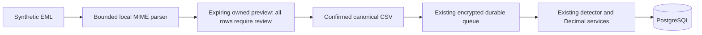

# Email receipt-import foundation

Owner-selected scope: build the receipt-import foundation using synthetic fixtures. Live Gmail
access and provider deals remain disabled. Free hosting and the locked beta remain unchanged.

## Decisions before implementation

- Deliver a development-only, opt-in EML preview API and an offline fixture evaluator. Do not
  present a connected Gmail account, implement mailbox access, request OAuth credentials, or
  create a third-party account. No email content goes to an LLM or any external service.
- Parse bounded MIME locally with the Python standard library. Ignore attachments, remote images,
  scripts, links and email instructions. Support explicitly labelled English INR paid receipts;
  unsupported/ambiguous fields require review, not guessed numbers. Do not use the email header
  date as a payment date or treat renewal notices, invoices, failed payments or refunds as charges.
- Each candidate requires explicit user verification. Reuse scoped statement-preview storage,
  expiry/cancellation/deletion, and the existing confirmed CSV/durable upload/detection/insights
  pipeline. Store extracted fields only, never original EML bytes, mailbox addresses or bodies.
- Add the source label `email_receipt` to the API contract. Existing database source columns are
  bounded strings and need no migration. No runtime schema creation is introduced.
- Prevent email/statement/demo mixing in both directions, under the existing ingestion lock.
  Receipt-to-bank reconciliation is not implemented; without this guard the same payment could
  inflate spending. Use a separate empty local account for fixture demonstrations.
- Replayed receipt charges use canonical merchant/date/Decimal amount and the existing database
  dedupe. A receipt is user-supplied evidence, not independent proof of settlement or authenticity.
- `RECEIPT_IMPORT_ENABLED=false` by default. Refuse production activation and reject public-demo
  uploads before reading the body even if the flag is accidentally enabled. Hosted UI stays intact.
- Creation requires the offline assistant. If an operator later selects a live provider, the
  existing per-attempt provider guard also blocks receipt workspaces before data can leave.

## Commercial expansion boundary

The brother's proposed next stage is an independently opted-in interest list and provider-approved
group offers. It is not permission to redistribute ordinary personal subscriptions or share login
credentials across customers. Pricing, licences, territories and concurrency require a provider
agreement before any offer is presented as available. No partners are contacted by this work.

Mailbox access is a separate purpose. Gmail-derived data will not feed commercial cohort reports,
advertising or provider negotiations in this design. Any future interest list must collect the
user's separate voluntary declaration without querying receipt/transaction history.

Google lists `gmail.readonly` as restricted; server storage/transmission entails additional
verification/security-assessment requirements. Consent alone is not a substitute for Limited Use
rules. A future live integration needs a separate reviewed design, approved data retention,
encrypted tokens, revocation/deletion, and the existing launch prerequisites.

Sources checked during planning:
- [Gmail scopes and verification](https://developers.google.com/workspace/gmail/api/auth/scopes)
- [Google Workspace Limited Use](https://developers.google.com/workspace/workspace-api-user-data-developer-policy)

## Local use (synthetic fixtures only)

PowerShell, with the existing Docker development setup:

```powershell
$env:RECEIPT_IMPORT_ENABLED = "true"
make dev
make receipt-demo
Remove-Item Env:RECEIPT_IMPORT_ENABLED
make dev
make evaluate-receipts
```

Linux/macOS equivalent: `RECEIPT_IMPORT_ENABLED=true make dev`, then `make receipt-demo`.
Run `make dev` without that override afterward to return to the default disabled state.
The demo command executes inside the API container, talks only to its localhost API, creates a
disposable local account, confirms the known synthetic fixtures, waits for real worker progress,
checks independent labels/totals and duplicate replay, and deletes its account in cleanup. It
refuses public/production mode, live AI, verification-mail profiles and required legal acceptance.
It never prints passwords, tokens, original messages or amounts. Fixture dates are pinned to
2026-10-18; this is a pipeline test, not a claim of current receipt renewals.

For manual API review, use a fresh local account and authorize in `/docs`:

1. `POST /api/v1/receipts/preview`: one `.eml` file, at most 1 MB. No extra form fields.
2. Inspect `result.rows` and warnings. Confidence is `0.00` pending review; every row is flagged.
   Legacy page counters represent one message/review unit, not PDF pages or OCR confidence.
3. `POST /api/v1/uploads`: form `preview_id` plus `edits`, for example
   `[{"index":0,"verified":true}]`. Correct missing/ambiguous fields first, using decimal strings.
4. Poll `GET /api/v1/uploads/{id}` for real progress. The result retains `source_type=email_receipt`.
5. `GET/DELETE /api/v1/uploads/previews/{id}` reuse scoped read/cancel; previews expire after the
   configured statement-preview TTL (default 30 minutes). Confirmation clears the temporary payload.



## Verification and limitations

Required and exercised coverage: independently
labelled MIME fixtures, ambiguous/no-charge/foreign-currency/malformed input, byte/part limits,
formula/HTML/instruction handling, preview ownership/expiry/cancellation, explicit review,
idempotent real-PostgreSQL import, cross-source exclusion, deletion, feature/public/production
guards, durable dispatch, and all existing regression/contract/evaluator gates.

This foundation does not claim real-provider template coverage, OAuth verification, Gmail sync,
bank reconciliation, an email-import UI, negotiated prices or a production launch.
Canonical merchant/date/amount dedupe may merge distinct identical charges. Message-ID/invoice
identity and cross-source reconciliation are not implemented; inspect duplicate counts. No receipt
is independently authenticated or bank-settled merely because a user has verified its fields.
Only the 16 synthetic EML filenames in the committed truth manifest may pass the source scan;
original user mail and outbox copies must remain ignored. Do not place private mail in fixtures.

### Verification receipts (2026-10-25/26)

- Baseline: master 1eda459, hosted checks 40216300877 green (earlier code, not this feature).
- `make openapi types evaluate-receipts`: exit0; 16/16 independent fixture outcomes.
- `RECEIPT_IMPORT_ENABLED=true make dev receipt-demo`: exit0 on real Compose. Eight reviewed
  fixture receipts, three expected products, independent Decimal totals, zero inserted on replay,
  account/data deletion. The demo imports via HTTP and the separate worker, never direct inserts.
- `make verify`: exit0 after stack startup. `make test lint evaluate`: final exit0, 521 real
  PostgreSQL tests (610.74s, one upstream deprecation warning), 75 frontend tests, contract drift,
  Ruff/ESLint/TypeScript, detector gate and extraction/receipt evaluators passed.
- Additional final `pytest -q tests/test_email_receipts.py`: 35 passed (22.13s), including the
  bounded 60,000-blank-line case after horizontal-whitespace parsing hardening.
- First full run: 520 passed/1 fixture-audit test failed because empty Cc/Bcc entries made Python's
  strict address parser reject the address list. The audit now checks only actual headers. The
  subsequent complete gate passed. This was not hidden or bypassed with a broad fixture exception.
- Linux Playwright against real Compose: 16 standard cases passed (Chromium10/Firefox3/WebKit3),
  strict same-site TLS1 passed, public-demo1 passed. New public checks refuse EML and the receipt
  route. Every-page light/dark mobile axe and responsive checks are part of the standard suite.
  The origin-preserving local runner and explicit test clock were restored afterward.
- Production build passed (main354.46kB, gzip111.65; lazy chart389.93kB, gzip114.22).
  `npm audit --audit-level=low`: 0; `pip-audit -r backend/requirements.lock --disable-pip`: none.
- Gitleaks: all74 reachable local commits and current source clean. Existing three exact
  historical synthetic JWT exceptions remain unchanged. Source scan now rejects unapproved EML
  filenames, including forced-tracked outbox copies. Tests validate reserved fixture addresses.
- Latest hosted results are available from the master checks workflow; only its exact-commit
  success authorizes updates to the existing demos. The hosted feature flag stays off.
